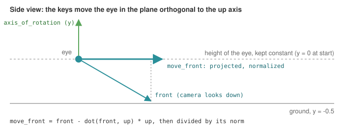

# Walk on a plane with the keyboard

**What it shows**: a first-person camera that **walks**: the arrow keys move the eye
forward, back and sideways, the mouse turns the head, and the height of the eye never changes,
even when you look up or down. The scene is a large checkerboard ground with a regular field of
thin poles, which makes the motion easy to perceive.

<!-- demo: camera-2d-displacement -->

> **Controls.** Click in the demo first, so that it receives the keys.
>
> | Input | Effect |
> |---|---|
> | Up / Down arrows, W / S (Z / S on AZERTY) | walk forward / back (1.5 units per second) |
> | Left / Right arrows, A / D (Q / D on AZERTY) | step left / right (half speed) |
> | Shift held with a key | run (3 times faster) |
> | Left drag | look around (left / right, up / down) |
> | Ctrl + left drag | tilt the up axis (the walking plane tilts with it) |
> | Right drag | walk forward / back |
> | Shift + C, Esc | capture the cursor (the head follows the mouse without a click), release it |

This page complements the how-to
[Explore a scene with a first-person camera](../how-to/explore-with-a-first-person-camera.md),
which was derived from this example and explains how to switch the camera of your own scene.
Here: what the controller does to stay on the plane, and the differences of the complete
program.

Source: [`examples/07_camera/02_camera_2d_displacement`](https://github.com/drohmer/epita_ani3d_lab_code-2027/tree/main/examples/07_camera/02_camera_2d_displacement)
of the public repository *epita_ani3d_lab_code-2027*, run unchanged in the demo above.

| File | Role |
|---|---|
| `src/scene.hpp`, `src/scene.cpp` | the scene: the controller, the ground, the poles, the callbacks |
| `assets/checkboard.png` | the 8 x 8 checkerboard of the ground |

## 1. A y-up scene

Unlike the how-to and the template (z up), this scene uses **y as the vertical axis**:

```cpp
// src/scene.cpp - initialize
camera_control.initialize(inputs, window); // Give access to the inputs and window global state to the camera controler
camera_control.set_rotation_axis_y();
```

There is no `look_at`: the camera starts at the origin, looking toward $-z$. The ground is a
quadrangle in the plane $y = 0$, scaled by 50 and moved down by 0.5, so the eye is 0.5 above
it; the checkerboard image is stretched once over the 100 x 100 units of the quadrangle, so
each square is 12.5 units wide.

## 2. How the controller stays on the plane

`camera_controller_2d_displacement` is a `camera_controller_first_person_euler` (yaw and pitch
around a fixed axis, the horizon stays horizontal) whose displacements are constrained. In its
`idle_frame`, the front and right directions of the camera are projected on the plane
orthogonal to the rotation axis, and normalized:

```cpp
// cgp/19_camera_controller/camera_controller_2d_displacement/camera_controller_2d_displacement.cpp - idle_frame
vec3 move_front = front - dot(front, up) * up;
if (float const len = norm(move_front); len > 1e-4f) move_front /= len;
// ... the same for move_right

if (inputs->keyboard.up || inputs->keyboard.is_pressed(GLFW_KEY_W))
    camera_model.position_camera += magnitude * move_front;
```



The first-person controller of CGP would move the eye along `front` itself
(`manipulator_translate_front`), and therefore into the ground when you look down. Here
`magnitude` is 1.5 times the duration of the frame (3 times more with Shift), and the right
drag of the mouse uses the same projected direction. Only the rotation axis defines the
plane: if you tilt it with Ctrl + left drag, the walk follows the tilted plane.

## 3. A field of poles drawn in a loop

```cpp
// src/scene.cpp - display_frame
for (int kx = -20; kx < 20; kx+=2) {
	for (int kz = -20; kz < 20; kz+=2) {
		if (kx != 0 || kz != 0) {
			cylinder.model.translation = { kx,-0.5f, kz };
			draw(cylinder, environment);
		}
	}
}
```

One `mesh_drawable` (a cylinder of radius 0.05 and height 1) is drawn 399 times per frame,
with a new `model` translation before each `draw`: a grid with a spacing of 2, without the pole
at the origin, where the camera starts. Each `draw` is one draw call. For a few hundred copies
this is fine; for thousands, the GPU can draw all the copies in one call with instancing, see
[Grass with per-instance positions](instancing-positions.md).

As in the fly example, the light is placed at the camera position at every frame
(`environment.light = camera_control.camera_model.position();`). The "Wireframe" checkbox draws
nothing in the browser (see [Display the wireframe](../how-to/display-the-wireframe.md)).

## Going further

- Walk on a terrain: after `camera_control.idle_frame()`, set the height of the eye from the
  height of the ground below it.
- Add collisions with the poles: before moving, reject a position closer than the radius to the
  nearest grid point.
- Compare with a camera that flies: [Fly over a terrain](fly-mode-camera.md).

## See also

- How-to: [Explore a scene with a first-person camera](../how-to/explore-with-a-first-person-camera.md)
- Understand: [Mouse, keyboard and camera controllers](../understand/interaction.md), [Camera and matrices](../understand/camera-and-matrices.md)
- Reference: [`camera_controller_first_person_euler`](../reference/camera_controller_first_person_euler.md), [`camera_first_person_euler`](../reference/camera_first_person_euler.md)
