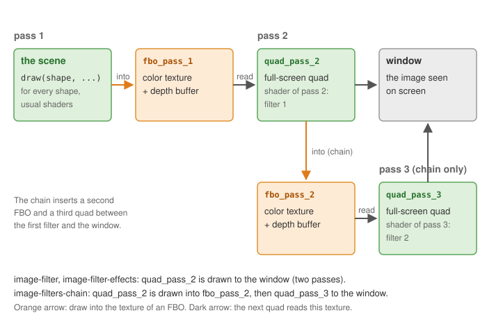

# A chain of two image filters

**What it shows**: the line drawing of [An image filter on the whole scene](image-filter.md),
with lines made thicker by a second filter. Thickening a line needs the result of the edge
filter at the neighboring pixels, and a fragment shader can read its input image but not
what the other fragments write. So the edge image is drawn into a second texture, and a
third pass applies the thickening filter to it. The "Thickness" slider sets the width of the lines.

<!-- demo: image-filters-chain -->

Concepts combined in this example:

- two `opengl_fbo_structure`: the output of one filter is the input of the next;
- two full-screen quads that share the same GPU buffers but have their own texture and
  shader;
- a minimum filter over a neighborhood (an erosion of the bright image), whose size is a
  loop bound sent as an integer uniform;
- a GUI slider that edits the value stored in `environment.uniform_generic` directly.

Source: [`examples/06_multipass/03_image_filters_chain`](https://github.com/drohmer/epita_ani3d_lab_code-2027/tree/main/examples/06_multipass/03_image_filters_chain)
of the public repository *epita_ani3d_lab_code-2027*, run unchanged in the demo above.

| File | Role |
|---|---|
| `src/scene.hpp`, `src/scene.cpp` | the scene of the first filter example, the three passes, the slider |
| `src/multipass_structure/multipass_structure.*` | the helper of [the first example](image-filter.md#1-the-helper-struct), extended to a second FBO and a third pass |
| `shaders/screen_effect_convolution/` | the edge filter (Laplacian), unchanged |
| `shaders/screen_effect_thickening/` | the thickening filter |

## 1. A second FBO and a third quad



```cpp
// src/multipass_structure/multipass_structure.cpp - initialize
fbo_pass_1.initialize();
fbo_pass_2.initialize();

// Initialize a simple quad used to display the result on the entire screen
quad_pass_2.initialize_data_on_gpu(mesh_primitive_quadrangle({ -1,-1,0 }, { 1,-1,0 }, { 1,1,0 }, { -1,1,0 }));
quad_pass_3 = quad_pass_2;

quad_pass_2.texture = fbo_pass_1.texture;
quad_pass_3.texture = fbo_pass_2.texture;
```

`quad_pass_3 = quad_pass_2` copies the ids of the buffers: both quads draw the same GPU
geometry. The assignments that follow give each one its own texture, and
`set_shader_pass_2` / `set_shader_pass_3` its own shader: changing these members of one copy
does not affect the other (see
[Copies, sharing and freeing](../understand/cpu-to-gpu.md#7-copies-sharing-and-freeing)).
`update_screen_size` now resizes both FBOs.

The only real change is where pass 2 draws:

```cpp
// src/multipass_structure/multipass_structure.cpp
void multipass_structure::start_pass_2() {
	fbo_pass_2.bind();
	clear_screen();
}
void multipass_structure::end_pass_2()
{
	fbo_pass_2.unbind();
}
void multipass_structure::start_pass_3() {
	clear_screen();
}
```

In the first example, pass 2 drew to the window; here it is wrapped in
`fbo_pass_2.bind()` / `unbind()`, and pass 3 takes the role of the final pass:
`draw_pass_3` draws `quad_pass_3` with the depth test off, as `draw_pass_2` does. In
`display_frame`, the three passes follow each other with the same start / draw / end
calls, and the global frame is drawn last, unfiltered.

## 2. The thickening filter

```glsl
// shaders/screen_effect_thickening/screen_effect_thickening.frag.glsl
uniform int thickness;

void main()
{
	ivec2 image_size = textureSize(image_texture, 0);
	float dx = 1.0 / float(image_size.x);
	float dy = 1.0 / float(image_size.y);

	vec4 color = vec4(1.0, 1.0, 1.0, 1.0);
	for (int kx = -thickness; kx < thickness; kx++) {
		for (int ky = -thickness; ky < thickness; ky++) {
			color = min(color, texture(image_texture, uv_frag + vec2(float(kx)*dx,float(ky)*dy)));
		}
	}
	FragColor = color;
}
```

Each pixel takes the darkest value, channel by channel, of a square of
$2\,\text{thickness} \times 2\,\text{thickness}$ pixels around it (offsets from
-thickness to thickness - 1). A pixel near a dark line therefore becomes dark: every line
grows by about `thickness` pixels on each side. In image processing, this minimum is an
*erosion* of the white image, that is a *dilation* of the dark lines.

The cost grows as the square of the thickness: at 10, the shader reads the texture
$20 \times 20 = 400$ times per pixel. Try the slider at its maximum on a large window. A
separable version (one pass for the minimum along x, a fourth pass along y) would need
$2 \times 20$ reads.

## 3. The thickness, from the slider to the shader

```cpp
// src/scene.cpp - initialize
environment.uniform_generic.uniform_int["thickness"] = 5;
environment.default_expected_uniform = false;

// src/scene.cpp - display_gui
ImGui::SliderInt("Thickness", &environment.uniform_generic.uniform_int["thickness"], 1, 10);
```

`uniform_int` is a `std::map<std::string, int>`: the slider receives the address of the
value stored in the map and edits it in place, and every following `draw` sends the new
value. As in the [effects example](image-filter-effects.md#3-a-time-uniform-for-the-animated-effects),
`default_expected_uniform = false` avoids a warning for each shape that receives
`thickness` without using it.

## Going further

- Chain a third filter: a blur after the thickening, for softer lines. Generalize
  `multipass_structure` to a vector of FBOs and quads instead of numbered members.
- Make the thickening separable, as described above, and compare the frame rate at
  thickness 10.
- Color the thick lines: in the last pass, read the original image (the texture of
  `fbo_pass_1`, given as a supplementary texture) and multiply it by the lines.

## See also

- Examples: [An image filter on the whole scene](image-filter.md), [Image effects: colors, contours, deformations](image-filter-effects.md)
- How-to: [Render the scene to a texture and filter it](../how-to/render-to-a-texture.md), [Add GUI controls](../how-to/add-gui-controls.md)
- Understand: [From CPU to GPU](../understand/cpu-to-gpu.md), [Shaders and uniforms](../understand/shaders-and-uniforms.md)
- Reference: [`opengl_fbo_structure`](../reference/opengl_fbo_structure.md), [`uniform_generic_structure`](../reference/uniform_generic_structure.md), [`mesh_drawable`](../reference/mesh_drawable.md)
