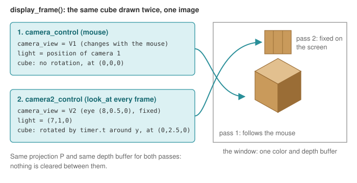

# Two cameras in one image

**What it shows**: the view matrix is only a value of the environment, read at each `draw`.
The example draws a cube with the camera driven by the mouse, then changes the view matrix,
the light and the transform of the cube, and draws it again. The second cube is seen by a
**second, fixed camera**: it turns on itself but stays at the same place on the screen,
whatever you do with the mouse.

<!-- demo: multiple-cameras -->

Concepts combined in this example:

- two camera controllers (`camera_controller_orbit_euler`), of which only one receives the
  mouse;
- `environment.camera_view` and `environment.light` changed between two `draw` calls of the
  same frame;
- the `model` transform of a `mesh_drawable` reset and changed between two draws;
- a rotation driven by a `timer_basic`.

Source: [`examples/07_camera/03_multiple_cameras`](https://github.com/drohmer/epita_ani3d_lab_code-2027/tree/main/examples/07_camera/03_multiple_cameras)
of the public repository *epita_ani3d_lab_code-2027*, run unchanged in the demo above. The view
matrix itself is explained in [Camera and matrices](../understand/camera-and-matrices.md#2-view-matrix-looking-from-the-camera).

| File | Role |
|---|---|
| `src/scene.hpp`, `src/scene.cpp` | the scene: two controllers, one cube drawn twice |
| `assets/wood.jpg` | the texture of the cube |

## 1. Two controllers, one connected to the mouse

```cpp
// src/scene.hpp - scene_structure
camera_controller_orbit_euler camera_control;  // default camera 
camera_controller_orbit_euler camera2_control; // camera for the environment 2
```

Both are initialized with `initialize(inputs, window)`, but the callbacks of the scene
(`mouse_move_event`, `keyboard_event`, `idle_frame`) only call `camera_control`: the second
camera never moves with the inputs. It is placed by a `look_at` at every frame.

Note on the up axis: the example calls `look_at` with a third argument `{0,0,1}`, but the
orbit_euler controller ignores it (its `look_at(eye, center, up)` keeps only the eye and the
center), and `set_rotation_axis_z()` is not called. Both cameras therefore keep the default
rotation axis of `camera_orbit_euler`, $y$: in the demo the green axis of the frame points up.

## 2. One frame, two passes



```cpp
// src/scene.cpp - display_frame (wireframe lines omitted, banner comments shortened)
environment.light = camera_control.camera_model.position();
timer.update(); // Update the time

// Reset the transformation applied to the cube
cube.model.rotation = rotation_transform(); 
cube.model.translation = { 0,0,0 };

// first camera
environment.camera_view = camera_control.camera_model.matrix_view();
if (gui.display_frame)
	draw(global_frame, environment);
draw(cube, environment);

// second camera
camera2_control.look_at({ 8,0.5,0 }, { 0,0,0 }, { 0,0,1 }); // change the camera2 position
environment.camera_view = camera2_control.camera_model.matrix_view();
environment.light = { 7,1,0 }; // change the light position
cube.model.rotation = rotation_transform::from_axis_angle({ 0,1,0 }, timer.t);
cube.model.translation = { 0,2.5,0 };
draw(cube, environment);
```

- `draw` sends the uniforms (`view`, `light`, `model`...) at the moment it is called (see
  [Shaders and uniforms](../understand/shaders-and-uniforms.md#3-three-levels-of-uniforms)):
  changing the environment between two draws changes what the next draw sees, not the previous
  one.
- The second cube is placed at $(0, 2.5, 0)$ in the world and seen from $(8, 0.5, 0)$ by a
  camera that never moves: its position on the screen is constant. It turns around $y$ by
  `timer.t` radians, one radian per second.
- The cube is a single `mesh_drawable`: its `model` keeps the last values set. That is why
  `display_frame` starts by resetting the rotation and the translation before the first pass.
- The light is also set back to the camera position at the start of the next frame.

## 3. What is shared between the two passes

Only the view matrix (and the light) change. The projection matrix is the same (it is set by
the application before `display_frame`, from `camera_projection`), and so are the color and
depth buffers: nothing is cleared between the passes. When you orbit until the two cubes
overlap on the screen, the depth test decides which one is visible with depths computed from
two different cameras, as if both cubes were in the same scene.

## Going further

- Split screen: before each pass, restrict the drawing to one half of the window with
  `glViewport`, and replace `environment.camera_projection` by a projection with the aspect
  ratio of the half window (the application computes it for the whole window).
- An overlay that is never hidden: clear the depth buffer before the second pass
  (`glClear(GL_DEPTH_BUFFER_BIT)`).
- A real picture-in-picture or a security-camera screen: render the second camera into a
  texture, then draw it on a quad, see [Render to a texture](../how-to/render-to-a-texture.md).
- Let the second camera be controlled too, with Ctrl held for instance: forward the events to
  `camera2_control` and remove its `look_at` from `display_frame`.

## See also

- How-to: [Explore a scene with a first-person camera](../how-to/explore-with-a-first-person-camera.md) (variation with a second, fixed camera), [Render to a texture](../how-to/render-to-a-texture.md)
- Understand: [Camera and matrices](../understand/camera-and-matrices.md), [Shaders and uniforms](../understand/shaders-and-uniforms.md), [Mouse, keyboard and camera controllers](../understand/interaction.md)
- Reference: [`camera_controller_orbit_euler`](../reference/camera_controller_orbit_euler.md), [`camera_orbit_euler`](../reference/camera_orbit_euler.md), [`timer_basic`](../reference/timer_basic.md)
