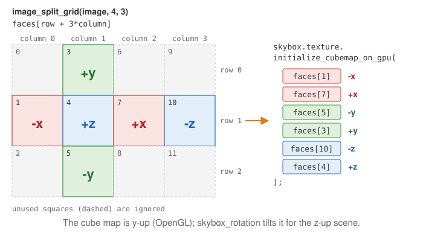

# A skybox around a y-up scene

**What it shows**: the smallest program with a skybox. The scene contains only the global
frame, surrounded by a photograph of a canyon that never gets closer when you move the
camera. One image in the shape of a cross is cut into the six faces of a cube map, and the
skybox is drawn first, before the frame. The camera turns around the **y** axis, which is
also the up axis of the cube map: the sky needs no rotation.

<!-- demo: skybox -->

Concepts combined in this example:

- `image_load_file` and `image_split_grid`, which cut the image into 4 x 3 squares;
- a `skybox_drawable` whose texture is a cube map built with `initialize_cubemap_on_gpu`;
- `glDepthMask` to draw the sky without writing the depth;
- an orbit camera set to the y-up convention with `set_rotation_axis_y`.

Source: [`examples/05_environment_map/01_skybox`](https://github.com/drohmer/epita_ani3d_lab_code-2027/tree/main/examples/05_environment_map/01_skybox)
of the public repository *epita_ani3d_lab_code-2027*, run unchanged in the demo above (only
the image is resized, to 2048 x 1536). The step-by-step recipe, for the z-up default
template, is [Add a skybox](../how-to/add-a-skybox.md); this page explains what differs in
the complete program.

| File | Role |
|---|---|
| `src/scene.hpp` | declares the member `skybox` (a `skybox_drawable`) |
| `src/scene.cpp` | builds the cube map in `initialize`, draws the sky first in `display_frame` |
| `assets/skybox_01.jpg` | the sky, a cross of 4 x 3 squares |
| `assets/skybox_02.jpg`, `assets/skybox_debug.png` | other images of the repository, named in comments only (not in the demo) |

## 1. One image, six faces

```cpp
// src/scene.cpp - initialize
image_structure image_skybox_template = image_load_file(project::path+"assets/skybox_01.jpg");

// Split the image into a grid of 4 x 3 sub-images
std::vector<image_structure> image_grid = image_split_grid(image_skybox_template, 4, 3);

skybox.initialize_data_on_gpu();
skybox.texture.initialize_cubemap_on_gpu(image_grid[1], image_grid[7], image_grid[5], image_grid[3], image_grid[10], image_grid[4]);
```



`image_split_grid` numbers the squares column by column: square $(\text{column}, \text{row})$
is `image_grid[row + 3*column]`. The six arguments of `initialize_cubemap_on_gpu` are the
faces -x, +x, -y, +y, -z, +z, so the indices 1, 7, 5, 3, 10, 4 pick the left, right, bottom
and top squares of the cross, then the far right one and the center. The image
`assets/skybox_debug.png` of the repository writes the index on each square: load it instead of
`assets/skybox_01.jpg` (the comments of `initialize` show the line) to check another sky image.

## 2. Why the sky needs no rotation here

A cube map follows the OpenGL convention: +y is up. The example sets the camera to the same
convention:

```cpp
// src/scene.cpp - initialize
camera_control.set_rotation_axis_y();
camera_control.look_at({ 3.0f, 2.0f, 2.0f }, {0,0,0}, {0,0,1});
```

`set_rotation_axis_y` makes the orbit camera turn around the y axis and keep it vertical on
screen. The third argument of `look_at` is ignored by `camera_controller_orbit_euler` (the
up direction is its rotation axis), so the horizon of the sky is horizontal and
`skybox.skybox_rotation` keeps its default value, the identity. In the default template,
z-up, the how-to page tilts the cube map instead with
`skybox_rotation` ([Add a skybox, step 3](../how-to/add-a-skybox.md#3-load-the-image-and-build-the-cube-map-once)).
The green axis of the global frame (y) points up in the demo.

## 3. Drawn first, without writing the depth

```cpp
// src/scene.cpp - display_frame
//  Must be called before drawing the other shapes and without writing in the Depth Buffer
glDepthMask(GL_FALSE); // disable depth-buffer writing
draw(skybox, environment);
glDepthMask(GL_TRUE);  // re-activate depth-buffer write

// Can now draw the other shapes of the scene
if (gui.display_frame)
	draw(global_frame, environment);
```

The `skybox_drawable` is a cube of size 2 centered on the camera: its vertex shader keeps
only the rotation of the view matrix (`mat3(view*model)`), so the cube moves with the camera
and the sky only turns. Its fragment shader reads the cube map in the direction of the
fragment. This cube is very close to the camera: if it wrote its depth, every shape behind
it, that is every shape of the scene, would fail the depth test. With `glDepthMask(GL_FALSE)`
the sky only paints the color buffer, and the frame drawn afterwards covers it.

The "Wireframe" checkbox comes from the template; nothing reads `display_wireframe` in this
example, so it has no effect.

## Going further

- Add a shape after the skybox and make it reflect the sky: the next example,
  [An environment map on several shapes](environment-map.md).
- Tint the sky with `skybox.color_blending` and `skybox.alpha_color_blending` (0: image
  only, 1: plain color), for a night or a fog effect.
- Switch the camera to `set_rotation_axis_z()` and watch the horizon become vertical: this is
  the case where `skybox_rotation` is needed.

## See also

- How-to: [Add a skybox](../how-to/add-a-skybox.md), [Reflect the environment on a shape](../how-to/reflect-the-environment.md)
- Understand: [Camera and matrices](../understand/camera-and-matrices.md)
- Reference: [`skybox_drawable`](../reference/skybox_drawable.md), [`image_structure`](../reference/image_structure.md), [`opengl_texture_image_structure`](../reference/opengl_texture_image_structure.md), [`camera_controller_orbit_euler`](../reference/camera_controller_orbit_euler.md)
