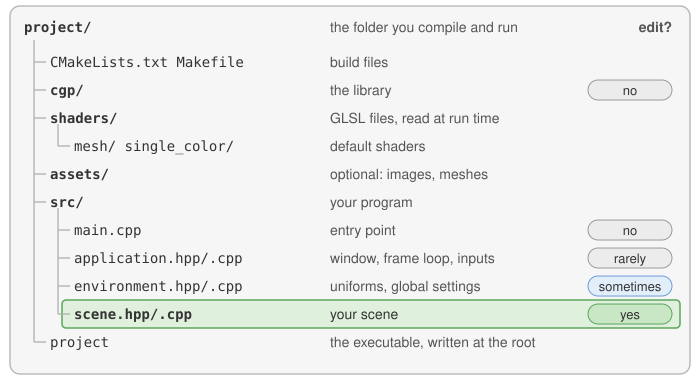

# Your first scene

Once the program compiles and runs (see [Install and compile](install.md)), it shows a red
sphere, a green cylinder rotating with time and the coordinate frame, with a small GUI window.
This page is a guided tour: find in the code what you see on the screen, then change it, step
by step, and check the result after each step. The complete reference of the template (what
the application does, who calls which function and in which order) is
[Scene structure](../understand/scene-structure.md).

<!-- demo: first-scene -->
> **Try it.** This is the unmodified template, compiled for the web: drag with the mouse to
> rotate the camera, and untick "Frame" in the GUI to hide the coordinate frame.

## 1. Where your code goes



Open the folder `src/`. You will only edit two files:

- `src/scene.hpp`: the **data** of your scene, the members of `scene_structure` (the shapes,
  the camera, the values edited in the GUI);
- `src/scene.cpp`: its **functions**: `initialize()` runs once at startup, `display_frame()`
  and `display_gui()` run at every frame.

The other files (`src/main.cpp`, `src/application.cpp`, `src/environment.cpp`) open the window, run the
loop and call these functions for you: see [Scene structure](../understand/scene-structure.md)
when you need to know how.

## 2. Find what you see in the code

| On the screen | In the code |
|---|---|
| the red sphere | `initialize()`: `sphere.initialize_data_on_gpu(...)`, its position `sphere.model.translation`, its color `sphere.material.color` |
| the green cylinder, rotating | `display_frame()`: `cylinder.model.rotation` is recomputed from the time `timer.t` at every frame |
| the coordinate frame and the "Frame" checkbox | `display_gui()`: `ImGui::Checkbox("Frame", ...)`; `display_frame()` draws `global_frame` only when it is ticked |
| the camera that turns when you drag | the callbacks `mouse_move_event()`... forward the mouse to `camera_control` ([all the controls](../understand/interaction.md#controls-as-coded)) |
| the white background | `environment.background_color`, white by default |

**Created once.** In `initialize()`, a shape is built on the CPU (a [mesh](../understand/glossary.md#mesh)),
copied to the GPU once, then placed and colored:

```cpp
// scene.cpp - in initialize() (already in the template)
sphere.initialize_data_on_gpu(mesh_primitive_sphere(0.25f));
sphere.model.translation = {-0.5f, 0.75f, 0.0f};
sphere.material.color = {1.0f, 0.0f, 0.0f};
```

**Drawn at every frame.** `display_frame()` copies the camera into the
[environment](../understand/glossary.md#environment), then draws each shape:

```cpp
// scene.cpp - in display_frame() (already in the template)
environment.camera_view = camera_control.camera().matrix_view();
environment.light = camera_control.camera_model.position();

if (gui.display_frame)
    draw(global_frame, environment);
draw(sphere, environment);

cylinder.model.rotation = rotation_transform::from_axis_angle({1,0,0}, timer.t);
draw(cylinder, environment);

timer.update();
```

`sphere` is a [drawable](../understand/glossary.md#drawable): `draw` sends its position and
color, and the camera matrices of the environment, to the GPU program that draws it (the
[shader](../understand/glossary.md#shader)) as [uniforms](../understand/glossary.md#uniform),
values that are the same for every vertex of the shape. Keep `display_frame()` light: it
should mostly call `draw` on shapes created in `initialize()`; creating a mesh and sending it
to the GPU at every frame is slow.

## 3. Change it, step by step

Compile and run after each step.

**1. Change the color of the sphere.** In `initialize()`, replace the color of the sphere
(red, green, blue components between 0 and 1):

```cpp
// scene.cpp - in initialize(), replace the line sphere.material.color = ...
sphere.material.color = {0.6f, 0.2f, 0.8f};
```

*Expected result*: the sphere is purple. More on colors in
[Change the color of a shape](../how-to/change-the-color.md).

**2. Change the background.** Add one line at the end of `initialize()`:

```cpp
// scene.cpp - add at the end of initialize()
environment.background_color = {0.85f, 0.9f, 1.0f};
```

*Expected result*: a light blue background. The application clears the screen with this color
at the beginning of every frame.

**3. Add a torus.** Three steps: declare, create, draw. Declare the new shape in
`src/scene.hpp`, next to the sphere and the cylinder:

```cpp
// scene.hpp - add in scene_structure
mesh_drawable torus;
```

Create it once, at the end of `initialize()`:

```cpp
// scene.cpp - add at the end of initialize()
torus.initialize_data_on_gpu(mesh_primitive_torus(0.4f, 0.1f));  // major and minor radius
torus.model.translation = {0.0f, 0.0f, 0.75f};
torus.material.color = {0.2f, 0.4f, 1.0f};
```

Draw it at every frame:

```cpp
// scene.cpp - add in display_frame(), before timer.update()
draw(torus, environment);
```

*Expected result*: a blue torus floats above the origin. If it does not appear, check that
`draw(torus, environment)` is in `display_frame()`, not in `initialize()`. Other shapes are
in [Create basic shapes](../how-to/create-basic-shapes.md).

**4. Add a slider.** The rotation of the cylinder uses `timer.t`, and `timer_basic` has a
`scale` member that multiplies the speed of time. Add one line to `display_gui()`:

```cpp
// scene.cpp - add in display_gui()
ImGui::SliderFloat("Time scale", &timer.scale, 0.0f, 5.0f);
```

*Expected result*: the GUI has a "Time scale" slider; move it and the cylinder turns faster,
slower, or stops at 0. Any variable can be edited this way; when it is a parameter of the
scene rather than of an existing object, add a member to `gui_parameters` (like the boolean
`display_frame`, edited by the "Frame" checkbox) and read it through `gui` in
`display_frame()`. More widgets in [Add GUI controls](../how-to/add-gui-controls.md).

## 4. What runs when

- `initialize()` runs **once**, after the window is open: build and send the shapes there.
- `display_gui()`, then `display_frame()` run at **every frame**, so a slider moved in the GUI
  is used by the draw calls of the same frame.
- The mouse and keyboard callbacks run when an **event** arrives, at the end of a frame.
- Anything that must survive from one frame to the next is a member of `scene_structure`, not a
  local variable of `display_frame()`.

The complete order of the calls, the shortcuts of the application (Shift+F, Shift+V), the
environment and the global settings `project::...` are in
[Scene structure](../understand/scene-structure.md).

## Next steps

- [Draw a mesh with a camera](../how-to/draw-a-mesh.md): the `mesh` / `mesh_drawable`
  pattern in detail, and how to change the shape, its color and its transform.
- [Create basic shapes](../how-to/create-basic-shapes.md) and
  [Change the color of a shape](../how-to/change-the-color.md): the shapes and colors you can
  use right away.
- [Troubleshooting and error messages](troubleshooting.md): what the messages printed by CGP
  mean, and what to do when nothing is displayed.
- [Scene structure](../understand/scene-structure.md), then
  [Camera and matrices](../understand/camera-and-matrices.md): what `camera_view` and
  `camera_projection` contain and how the camera controller computes them.
- Unknown word? See the [Glossary](../understand/glossary.md).
