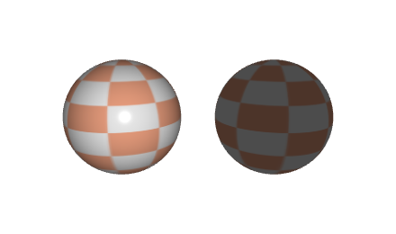
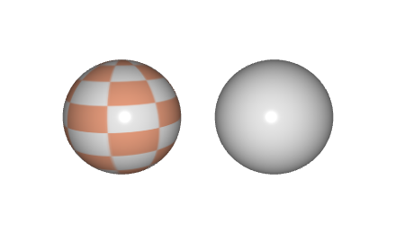
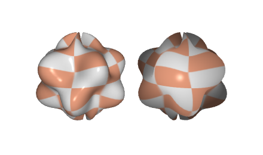
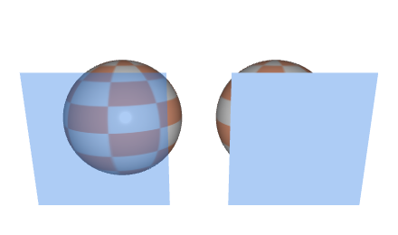

# Troubleshooting and error messages

This page lists the messages that CGP prints when something goes wrong **while the program
runs**, with their cause and the fix. Search for the first line of your message, or for the
symptom (nothing displayed, black shape, segmentation fault). Problems of installation and
compilation are in [Install and compile](install.md#troubleshooting).

## How to read a CGP error

When a check fails, CGP stops the program and prints a block like this one (here, a missing
file):

```text
libc++abi: terminating due to uncaught exception of type std::logic_error:
===============
ERROR detected !

Error found at this point of the code:
-------------------------------------
  - File: cgp/03_files/files.cpp
  - Line: 50
  - Function: assert_file_exist
  - Error message: Error cannot access the following file path
    "assets/missing.obj"
...
>> Please check all the error messages above on the command line to help you understand the issue.
```

- The first line depends on the system: the template builds define `CGP_ERROR_EXCEPTION`, so
  the error is a C++ exception (`std::logic_error`). macOS prints
  `libc++abi: terminating due to uncaught exception of type std::logic_error`, Linux (GCC)
  prints `terminate called after throwing an instance of 'std::logic_error'` followed by
  `what():`, and Visual Studio stops in the debugger.
- **File, Line, Function** are where the check is, inside CGP: the mistake is in *your* code
  that called this function. Run the program in a debugger (VS Code, Visual Studio, *lldb* or
  *gdb*) and look at the call stack to find the line of your code.
- **Assert failed on the condition** is the test that failed (for instance `L>1e-6f`), and
  **Error message** explains it.
- Read also the lines printed just **before** the block: some functions (shader compilation,
  mesh check) print the details there.

Warnings do not stop the program. They start with `[Warning cgp]` and the same warning is
printed at most 4 times (set `cgp_warning::max_warning` to change it; 0 removes them).

In the web build (Emscripten), the assertions are disabled (`CGP_NO_DEBUG`): the same mistake
gives no CGP message, but a wrong drawing or a crash reported in the console of the browser.
Debug in the desktop build first.

## At start-up

### The program failed to locate the ressource directory

```text
[Parameters ERROR] The program failed to locate the ressource directory designed as: shaders/
Please check if this directory exists.
```

**Cause**: the program looks for the folder `shaders/` from the folder it is run from (and up
to four parent folders), and does not find it. **Fix**: run the program from the root of the
project, or from a build folder inside it; in an IDE, set the working directory of the run
configuration. See [Run the program from the right folder](install.md#run-the-program-from-the-right-folder).

### Error: No monitor found (glfwGetPrimaryMonitor)

```text
Error: No monitor found (glfwGetPrimaryMonitor).
The program needs access to a display: run it from a graphical session (not over SSH without display forwarding).
```

**Cause**: the program has no access to a screen (remote session over SSH, process started
outside the desktop session). **Fix**: run it from the desktop session.

### Error: Failed to Initialize GLFW / Failed to create GLFW Window

```text
Error: Failed to Initialize GLFW.
If you are using WSL or Linux without graphical server, you need to start a X-server
```

```text
Failed to create GLFW Window
	 Possible error cause: Incompatible OpenGL version (requesting OpenGL 3.3)
```

**Cause**: no graphical server (WSL, Linux console), or a graphics driver without OpenGL 3.3
(virtual machine, remote desktop, outdated driver). **Fix**: start an X server under WSL,
update the graphics driver, or use the computer directly instead of a remote session.

## Files

### Error cannot access the following file path

```text
  - Error message: Error cannot access the following file path
    "assets/texture.png"

    => If the file exists, you may need to adapt the path from which you run the program
```

**Cause**: a file loaded by CGP (image, OBJ, shader) does not exist at this path. Most of the
time the file exists, but the path is relative to the folder the program is run from.
**Fix**: always build the paths with `project::path`, which points to the root of the
project wherever the program is run from:

```cpp
image_structure image = image_load_file(project::path + "assets/texture.png");
mesh shape = mesh_load_file_obj(project::path + "assets/model.obj");
```

Check also the spelling and the case of the name (Linux and the web build are case
sensitive), and, for the web build, that the file is in `assets/` when you compile: the folder
is packed into the `.data` file at build time.

### Warning: Cannot read the vertex shader at location

```text
Warning: Cannot read the fragment shader at location shaders/my_shader/my_shader.frag.glsl
If this file exists, you may need to adapt the directory from where your program is executed
```

Same cause and fix as above, for a shader loaded with `opengl_shader_structure::load`; the
program then stops with the error block of the missing file.

## Shaders

### Failed to compile the Fragment Shader (or the Vertex Shader)

```text
[Info from shader compilation]
ERROR: 0:77: ... (message of the graphics driver)
Compilation Failed
===> Failed to compile the Fragment Shader [shaders/my_shader/my_shader.frag.glsl]
The error message from the compiler should be listed above. The program will stop.
```

**Cause**: an error in the GLSL code. The message of the compiler, printed after
`[Info from shader compilation]`, depends on the graphics driver; `0:77` means line 77 of the
file (`ERROR: 0:77: ...`). The line given is often the one *after* the mistake (a missing `;`).
**Fix**: correct the shader at this line; no need to recompile the C++ code when you only
change a shader, just run the program again.

The web build compiles the shaders as GLSL ES 3.00 (CGP replaces the first line
`#version 330 core` by `#version 300 es`), which is stricter: no implicit conversion from
int to float (write `1.0`, not `1`, for a float). A shader that compiles on the desktop can fail in the browser.

### Failed to link the shaders into a fragment program

```text
Failed to link the shaders into a fragment program with the following shaders [...vert.glsl,...frag.glsl]
```

**Cause**: the two shaders compile but do not fit together, typically an *in* variable of the
fragment shader without a matching *out* of the vertex shader (different name or type).
**Fix**: read the lines after `[Info from shader Link]` and make the declarations match.

### Try to send uniform variable [...] to a shader that doesn't use it

```text
[Warning cgp] Try to send uniform variable [my_time] to a shader that doesn't use it.
 Either change the uniform variable to expected=false, or correct the associated shader (id=3).
```

**Cause**: the C++ code sends a uniform that the shader does not have, either because it is not
declared, its name differs, or it is declared but **not used**: the GLSL compiler removes
unused uniforms. **Fix**: check the name and use the uniform in the shader, or pass
`expected = false` when the uniform is optional (see
[Send a custom uniform to a shader](../how-to/send-a-custom-uniform.md)).

## Drawing

### Try to draw mesh_drawable without shader

```text
  - Assert failed on the condition: drawable.shader.id != 0
  - Error message: Try to draw mesh_drawable without shader
```

**Cause**: the drawable has no shader program. Typically a custom shader was passed to
`initialize_data_on_gpu` before it was loaded (its id was still 0), or the shader was
replaced by an empty `opengl_shader_structure`. The same message exists for `curve_drawable`
(`Try to draw curve_drawable without shader`). **Fix**: load the shader first, then
initialize the drawable with it, or assign it after loading: `shape.shader = my_shader;`.

`Try to draw mesh_drawable with incorrect shader` means that the id is not a valid program
anymore: the shader was deleted (`clear()`) while drawables still use it.
`Try to draw mesh_drawable without texture` is the same problem for the texture (a texture
passed to `initialize_data_on_gpu` before it was loaded).

### Calling initialize_data_on_gpu() on a mesh_drawable with non zero VBOs

```text
[Warning cgp] Calling initialize_data_on_gpu() on a mesh_drawable with non zero VBOs
  > You are calling initialize_data_on_gpu on an non-empty mesh_drawable
[Warning cgp] Calling [vbo].initialize_data_on_gpu() on a non empy VBO
```

**Cause**: `initialize_data_on_gpu` is called a second time on the same drawable, most often
in `display_frame()`, so at every frame. Each call allocates new GPU buffers and loses the
old ones: the program slows down and its memory grows. **Fix**: call it once in
`initialize()`. To change the shape later, update the buffers
(`shape.vbo_position.update(...)`, see [Update a mesh at every frame](../how-to/update-a-mesh-every-frame.md)),
or call `shape.clear()` before a new initialization. If the drawable is a copy of another
one, assign `shape = mesh_drawable();` instead: `clear()` would delete the buffers of the
other one too (see [Copies, sharing and freeing](../understand/cpu-to-gpu.md#7-copies-sharing-and-freeing)).

### Warning try to generate mesh_drawable with 0 vertex

The mesh given to `initialize_data_on_gpu` is empty: a file that loaded nothing, a mesh
filled after the upload, or a marching cubes without any surface in the domain. The drawable
stays empty and draws nothing.

### Warning [mesh_check] ... Cannot send this mesh data to GPU

```text
Warning [mesh_check]: Mesh has incoherent size of per-vertex color
  - Assert failed on the condition: mesh_check(data)
  - Error message: Cannot send this mesh data to GPU in initializing mesh_drawable
```

**Cause**: a mesh built by hand whose arrays do not match: `normal`, `color` or `uv` with a
size different from `position`, or a triangle using an index beyond the number of vertices
(`Triangle ... has index triplet ... exceeding the size of the position`). **Fix**: fill all
the arrays with the same size, or call `fill_empty_field()` after setting `position` and
`connectivity` (see [Build a mesh by hand](../how-to/build-a-mesh-by-hand.md)).

### OpenGL ERROR detected

```text
  - Error message: OpenGL ERROR detected
	File ...
	Function ...
	OpenGL Error: GL_INVALID_OPERATION
```

**Cause**: an OpenGL call failed; CGP checks the error state after its own calls, so the
failing call may be one of yours just before (wrong buffer, uniform of the wrong type,
texture parameter...). **Fix**: look at the call stack, and at your OpenGL calls made since the
previous CGP call.

## Indices, vectors and shapes

### Out-of-bounds access on container

```text
  - Function: check_index_bounds
  - Error message:
	> Out-of-bounds access on container numarray<vec3>
	>    - index = 3 is outside the valid range [0, 2]  (axis size = 3)
	> The index reached or exceeded the size of the container.
	  Help: indices start at 0; a typical loop runs from index=0 while index<size().
```

**Cause**: an index outside a `numarray`, a `vec3` (`v[3]`), a matrix or a grid
(`grid_2D` reports the axis: `x = 4 is outside the valid range`). With a negative index, the
message says `A container cannot be accessed with a negative index`; with an empty container,
`The container is empty`. **Fix**: find the access in the call stack; check the bounds of the
loop (`<` and not `<=`), and that the container was resized before.

Accesses through `std::vector` are not checked by CGP: an index out of bounds there is a
segmentation fault or a silent bug.

### Tried to normalize a vector with very small norm

```text
  - Function: normalize
  - Error message: Tried to normalize a vector vec3[0.000000 0.000000 0.000000] with very small norm (0.000000)
```

**Cause**: `normalize` of a null vector, often the difference of two equal points, a cross
product of parallel vectors, or a velocity at rest. **Fix**: test the norm before normalizing.

### Vector ... must have a unit norm

```text
  - Function: from_vector_transform
  - Assert failed on the condition: is_equal(norm(e_source), 1.0f)
  - Error message: Vector e_source=0.000000 0.000000 2.000000 must have a unit norm (2.000000)
```

`rotation_transform::from_vector_transform` expects unit vectors: normalize them first.

### Cylinder has 0 length, Too short arrow

```text
  - Function: mesh_primitive_cylinder
  - Assert failed on the condition: L>1e-6f
  - Error message: Cylinder has 0 length
```

The two points of `mesh_primitive_cylinder` are equal. For `mesh_primitive_arrow`,
`Too short arrow - length of cone > length of array`: the arrow is shorter than its tip,
reduce its radius. The other primitives check their radius and their number of samples the
same way (see [Create basic shapes](../how-to/create-basic-shapes.md)).

## Hierarchies

### Error: cannot find element [...] in hierarchy_mesh_drawable

```text
Error: cannot find element [arm] in hierarchy_mesh_drawable
Possibles element names are: [body]
```

**Cause**: `hierarchy["arm"]` with a name that was never added (spelling, case, or the
element is added later in `initialize()`). **Fix**: use one of the names listed.

### Error: Hierarchy not valid ... used before being defined

```text
Error: Hierarchy not valid
Element (arm,1) has parent name (missing_parent) used before being defined

Display hierarchy for debugging:
Element [0] body has parent: global_frame
Element [1] arm has parent: missing_parent
```

**Cause**: an element is added with a parent that is not in the hierarchy yet: the parent
name is misspelled, or the parent is added after its child. **Fix**: add the elements from the
root to the leaves; only the first element has a parent outside the hierarchy (by default
`global_frame`). See [Hierarchies of shapes](../understand/hierarchies.md).

## Camera

### Assert failed on the condition: inputs != nullptr

```text
  - Function: is_ready
  - Assert failed on the condition: inputs != nullptr
```

**Cause**: the camera controller was used before `camera_control.initialize(inputs, window)`;
this happens when the controller of the template is replaced by another type and the
initialization line is removed. **Fix**: keep `camera_control.initialize(inputs, window);` at
the beginning of `initialize()` (see [Explore a scene with a first-person camera](../how-to/explore-with-a-first-person-camera.md)).

## Symptoms without a message

These bugs print nothing: the program runs, but the image is wrong. The figures below come
from the demo of this section: the left sphere is correct, the right one shows the symptom.
Choose a symptom in its GUI to compare them from every side.

<!-- demo: visual-diagnostics -->

When the cause is not obvious, simplify until the image is right again, one step at a time:
set `material.color` to a bright color and `material.texture_settings.active = false`
(color and texture are out of the question), draw the shape with the default shader (your
shader is out of the question), then display its wireframe (see
[Display the wireframe of a mesh](../how-to/display-the-wireframe.md)): the geometry is out
of the question when it looks right.

### Nothing is displayed

The window shows only the background color (white by default):

- `draw(shape, environment)` is not called in `display_frame()`, or `initialize_data_on_gpu`
  was not called: drawing an empty `mesh_drawable` silently does nothing.
- The shape is outside the view: behind the camera, farther than the far plane (1000), or
  much larger than the scene so that the camera is **inside** it (you see its inner side, dark,
  or nothing). Print its position, and look at it with `camera_control.look_at`.
- `model.scaling` is 0, or `material.alpha` is 0 with blending enabled.
- The scene is drawn with your own shader that writes no color, or puts the vertices outside
  the screen (check `gl_Position` and the order of the matrices).

### A shape is black or very dark

The default shader multiplies the vertex color, `material.color` and the texture, then
applies the lighting (see [Change the color of a shape](../how-to/change-the-color.md)):

- **One color factor is zero**: `material.color` set to `{0,0,0}`, vertex colors left at
  zero, or a texture that did not load as expected.
- **The normals are wrong**: a mesh built by hand without normals (all null), or normals
  pointing inside the shape. The diffuse and specular terms vanish and only the ambient term
  remains (30% of the color): the shape is dark and flat, with no highlight.

  

  Fix: compute the normals with `normal_update()` after filling `position` and
  `connectivity`; if they point inside, reverse the order of the triangle indices
  (`flip_connectivity()`) and call `normal_update()` again.
- **You see the back of a surface**: the inside of an open cylinder, the lower side of a grid
  or a disc. Its normals point away from the light: only the ambient term remains. Set
  `material.texture_settings.two_sided = true`, or orient the surface toward the camera.
- **The light is not where you think**: the template moves `environment.light` to the camera
  at every frame; without this line the light stays at `{1,1,1}` and may be inside or
  behind your shape.

### The texture is uniform, or looks wrong



- **One uniform color**: the `uv` coordinates are missing or all equal (a mesh built by hand
  that fills `position` but not `uv`): every pixel reads the same texel. Fill `uv`, one
  coordinate in [0,1]^2 per vertex (see [Build a mesh by hand](../how-to/build-a-mesh-by-hand.md)).
- **Upside down**: CGP flips the image vertically by default
  (`material.texture_settings.inverse_v`, true). Set it to false for an image whose first
  row is the bottom one.
- **Stretched or tiled where you do not expect it**: the uv go beyond [0,1] and the wrap
  mode decides what happens there (`GL_CLAMP_TO_EDGE` by default, `GL_REPEAT` to tile); see
  [Apply a texture image](../how-to/apply-a-texture.md).
- **White, or the plain color of the material**: the drawable still uses the default 1 x 1
  white texture: the texture was loaded into a variable but never assigned to the drawable
  (`shape.texture = ...`), or `material.texture_settings.active` is false.

### The lighting does not follow a deformation



The vertices were moved (on the CPU, then `vbo_position.update`) but the normals were not
recomputed: the shape changes, its shading does not. Call `normal_update()` on the mesh after
moving the vertices, and update `vbo_normal` too (see
[Update a mesh at every frame](../how-to/update-a-mesh-every-frame.md)). A deformation
computed in a vertex shader has the same problem: the shader must also compute the new normal.

### A transparent shape hides what is behind it



The transparent shape was drawn before the shapes behind it, with depth writing on: the
depth buffer then rejects everything behind it, which is never drawn. Draw the opaque shapes
first, then the transparent ones from the farthest to the nearest, with `glDepthMask(false)`
during the transparent ones (see [Draw transparent objects](../how-to/draw-transparent-objects.md)).
A shape with `material.alpha` below 1 but no visible transparency: blending is not enabled
(`glEnable(GL_BLEND)`), or its texture has no alpha channel (JPEG).

### Changing one shape changes another

Two drawables share their GPU data when one is a copy of the other (`b = a`, or
`hierarchy.add(a, ...)`, which stores a copy): updating the buffers of one (`vbo_position.update`)
deforms both, and `clear()` on one breaks the other. Their `model` and `material` stay
separate. See [Copies, sharing and freeing](../understand/cpu-to-gpu.md#7-copies-sharing-and-freeing).

### Segmentation fault, or the program closes without a message

- **An index out of bounds** in a `std::vector`, a C array, or in a CGP container compiled
  with `CGP_NO_DEBUG` (always the case in the web build): no check, so a crash or a silent bug.
- **OpenGL used before the window exists**: `initialize_data_on_gpu`, `load` of a shader or a
  texture called in a constructor or in the initializer of a global variable. The OpenGL
  functions are loaded when the window is created, just before `initialize()`: do all GPU work
  in `initialize()` or later.
- **A reference or pointer to an element of a container that grew**: after `push_back`, the
  references to the elements of a `std::vector` or a `numarray` may be invalid.

To find the line, run the program in a debugger and read the call stack at the crash
(`lldb ./project` then *run* and *bt* in a terminal, or the debugger of the IDE).

### The program is slow

Look for `initialize_data_on_gpu`, `mesh_primitive_*`, `image_load_file` or `load` called in
`display_frame()`: build and upload once, in `initialize()`. The frame rate is limited to 60
by default (GUI, Window > FPS limiting), and a debug build is several times slower than a
release build.

### A key does nothing, or the wrong key reacts

GLFW key codes are positions on a US keyboard: on an AZERTY keyboard `GLFW_KEY_Z` is the key
labeled W. See [Mouse, keyboard and camera controllers](../understand/interaction.md).

## See also

- Get started: [Install and compile](install.md), [Your first scene](first-scene.md)
- How-to: [Draw a mesh with a camera](../how-to/draw-a-mesh.md) (common pitfalls)
