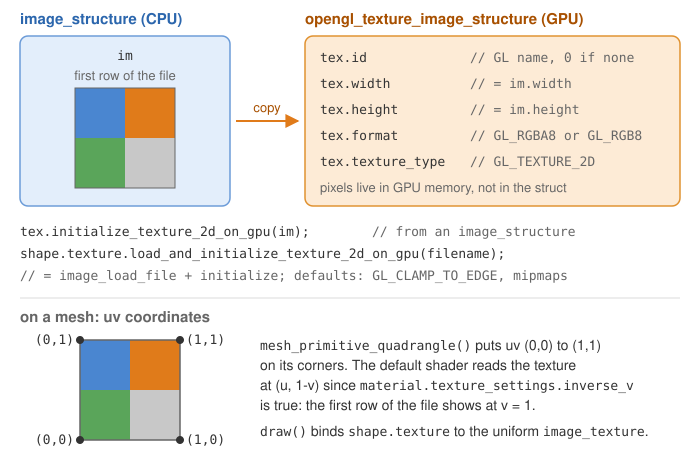

# Apply a texture image

**Goal**: cover a ground plane with a checkerboard image, and repeat a wood image on a
shape.

> **Starting point**: the default project template (`src/scene.hpp`, `src/scene.cpp`, see
> [Your first scene](../get-started/first-scene.md)). It already declares the shapes `sphere`
> and `cylinder`, a `timer`, and the members `camera_control`, `environment` and `gui`: reuse
> them, do not declare them again. The first comment of each code block says in which file
> and where its lines go: *add* means insert them, *replace* means replace the whole function by the one shown.

<!-- demo: apply-a-texture -->

## How the image is mapped

Each vertex of a `mesh` has a texture coordinate `uv` in `[0,1]^2`: `(0,0)` is the
bottom-left corner of the image and `(1,1)` the top-right corner. The default shader reads
the image color at the interpolated `uv` of each pixel and multiplies it by the vertex
color and by `material.color`.



The `mesh_primitive_*` functions and `mesh_load_file_obj` already fill `uv`. For a mesh
built by hand, see [Build a mesh by hand](build-a-mesh-by-hand.md).

## 1. Put the image in the project

The template has no image. Download the two images used on this page:

- [checkerboard.png](../assets/download/checkerboard.png) (600 x 600, 5 KB)
- [wood.jpg](../assets/download/wood.jpg) (256 x 256, 28 KB)

Create a folder `assets/` at the root of the project, next to `shaders/` and `src/`, and
save the images in it: `assets/checkerboard.png` and `assets/wood.jpg`. Any PNG or JPEG
image works the same way.

## 2. Declare the drawable

```cpp
// scene.hpp - add in scene_structure
mesh_drawable ground;
```

## 3. Create the shape, then load the texture (once)

```cpp
// scene.cpp - add at the end of initialize()
float const L = 3.0f;
ground.initialize_data_on_gpu(mesh_primitive_quadrangle(
    {-L,-L,-0.5f}, {L,-L,-0.5f}, {L,L,-0.5f}, {-L,L,-0.5f}));

ground.texture.load_and_initialize_texture_2d_on_gpu(project::path + "assets/checkerboard.png");
```

The ground is placed at z = -0.5, under the sphere and the cylinder of the template (they
are centered at z = 0, and the cylinder goes down to z = -0.5).

`load_and_initialize_texture_2d_on_gpu` reads the file, sends the pixels to the GPU and
stores the texture handle in `ground.texture`. Without it, the drawable uses a default
1x1 white texture, which is why untextured shapes show their plain `material.color`.

## 4. Draw (every frame)

```cpp
// scene.cpp - add in display_frame(), before timer.update()
draw(ground, environment);
```

Nothing else is needed: `draw` binds the texture automatically. Expected result: a
6 x 6 square under the red sphere and the green cylinder, covered by one copy of the
checkerboard.

## Repeat the image: wrap mode

When `uv` goes beyond `[0,1]`, the wrap mode decides what is displayed. Pass it as the
second (s, along u) and third (t, along v) arguments. This code **replaces** the code of
step 3 in `initialize()` (keep steps 2 and 4): a drawable is initialized only once, and
initializing ground a second time prints warnings about non-empty buffers.

```cpp
// scene.cpp - in initialize(), instead of the code of step 3
// 4 x 4 copies of the image on the ground
float const L = 3.0f;
mesh ground_mesh = mesh_primitive_quadrangle({-L,-L,-0.5f}, {L,-L,-0.5f}, {L,L,-0.5f}, {-L,L,-0.5f});
for (vec2& uv : ground_mesh.uv)
    uv = 4.0f * uv;
ground.initialize_data_on_gpu(ground_mesh);
ground.texture.load_and_initialize_texture_2d_on_gpu(
    project::path + "assets/wood.jpg", GL_REPEAT, GL_REPEAT);
```

| Wrap mode (OpenGL) | Outside `[0,1]` |
|---|---|
| `GL_CLAMP_TO_EDGE` (default) | the border pixels are stretched |
| `GL_REPEAT` | the image is tiled |
| `GL_MIRRORED_REPEAT` | tiled, every other copy mirrored |
| `GL_CLAMP_TO_BORDER` | a constant border color |

![With uv beyond [0,1], GL_REPEAT tiles the image, GL_MIRRORED_REPEAT flips every other copy, and GL_CLAMP_TO_EDGE (the default) stretches the edge texels.](../assets/reference/opengl_texture_wrap.svg)

## Common pitfalls

- **The program stops with an error on the file name**: the image was not found; check
  the path and that `assets/` is at the root of the project (next to `shaders/`), not in
  `src/` or in the build folder.
- **The shape has a single uniform color**: the mesh has no meaningful `uv` (all zero),
  so every pixel reads the same texel. Fill `uv` when you build the mesh.
- **The image is upside down**: images are stored top row first, so the default shader
  flips v (`material.texture_settings.inverse_v` is true by default). Set it to
  false for a texture that is already flipped, or flip v in the mesh.
- **The texture looks tinted**: the image color is multiplied by `material.color`; keep
  it white `{1,1,1}` to see the image as is.

## Variations

- Same image on several shapes: load it once into an `opengl_texture_image_structure`
  variable and assign it, `cube.texture = wood_texture;` (only the GPU handle is copied).
- Image computed on the CPU (procedural, simulation): `initialize_texture_2d_on_gpu`
  takes a `grid_2D<vec3>` or an `image_structure`, and `update` re-sends a modified one
  at each frame.
- Transparent pixels (PNG alpha channel): see
  [Draw transparent objects](draw-transparent-objects.md).

Source: course labs of CSC_43043 ([public version](https://github.com/drohmer/csc43043ep-lab-code), without the solutions): [`05_shaders/a_shader_manipulation`](https://github.com/drohmer/csc43043ep-lab-code/tree/main/05_shaders/a_shader_manipulation) (checkerboard ground),
[`07_texture/a_uv_texture`](https://github.com/drohmer/csc43043ep-lab-code/tree/main/07_texture/a_uv_texture) (`GL_CLAMP_TO_BORDER`) and [`08_project`](https://github.com/drohmer/csc43043ep-lab-code/tree/main/08_project) (palm tree with
`GL_REPEAT`), scene.cpp.

## See also

- How-to: [Build a mesh by hand](build-a-mesh-by-hand.md), [Load a 3D model from an OBJ file](load-an-obj-file.md), [Change the color of a shape](change-the-color.md) (tint a texture)
- Understand: [From CPU to GPU](../understand/cpu-to-gpu.md), [Shaders and uniforms](../understand/shaders-and-uniforms.md)
- Reference: [`opengl_texture_image_structure`](../reference/opengl_texture_image_structure.md), [`mesh_drawable`](../reference/mesh_drawable.md), [`mesh`](../reference/mesh.md)
