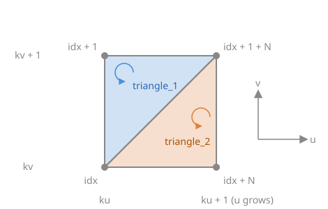

# Build a mesh by hand

**Goal**: create a textured square from its 4 vertices and 2 triangles, then generalize
to a surface sampled on an N x N grid.

> **Starting point**: the default project template (`src/scene.hpp`, `src/scene.cpp`, see
> [Your first scene](../get-started/first-scene.md)). It already declares the shapes `sphere`
> and `cylinder`, a `timer`, and the members `camera_control`, `environment` and `gui`: reuse
> them, do not declare them again. The first comment of each code block says in which file
> and where its lines go: *add* means insert them, *replace* means replace the whole function by the one shown.

<!-- demo: build-a-mesh-by-hand -->

## What a `mesh` contains

A `mesh` is a set of arrays (`numarray`) stored on the CPU:

| Field | Type | One entry per | Role |
|---|---|---|---|
| `position` | `numarray<vec3>` | vertex | 3D coordinates |
| `normal` | `numarray<vec3>` | vertex | normal used for lighting |
| `color` | `numarray<vec3>` | vertex | RGB color, multiplied by `material.color` |
| `uv` | `numarray<vec2>` | vertex | texture coordinates |
| `connectivity` | `numarray<uint3>` | triangle | the 3 vertex indices of the triangle |

All per-vertex arrays must have the same size. Indices start at 0.

## 1. Fill positions, uv and triangles

```cpp
// scene.cpp - add at the end of initialize()
mesh quad;
quad.position     = { {-1,-1,0}, {1,-1,0}, {1,1,0}, {-1,1,0} };
quad.uv           = { {0,0}, {1,0}, {1,1}, {0,1} };
quad.connectivity = { {0,1,2}, {0,2,3} };   // two triangles, counter-clockwise
```

```text
 3 ---- 2      triangle {0,1,2}
 |    / |      triangle {0,2,3}
 |  /   |
 0 ---- 1      (seen from +z)
```

## 2. Complete the missing fields

```cpp
// scene.cpp - add at the end of initialize(), after the lines of step 1
quad.fill_empty_field();
```

`fill_empty_field` fills every per-vertex array that is shorter than `position`: normals
are computed from the triangles, colors are set to white and uv to `{0,0}`. Without it,
`initialize_data_on_gpu` stops with an error because the buffers do not have the same
size.

## 3. Upload and draw

```cpp
// scene.hpp - add in scene_structure
mesh_drawable shape;
```

```cpp
// scene.cpp - add at the end of initialize(), after the lines of step 2
shape.initialize_data_on_gpu(quad);
shape.model.translation = {0, 0, -0.5f};   // under the sphere and the cylinder of the template
shape.texture.load_and_initialize_texture_2d_on_gpu(project::path + "assets/checkerboard.png");
```

```cpp
// scene.cpp - add in display_frame(), before timer.update()
draw(shape, environment);
```

The image `assets/checkerboard.png` is the one of
[Apply a texture image](apply-a-texture.md), which explains where to download it and
where to put it; any PNG or JPEG image works.

## Generalization: a surface on an N x N grid

For a surface p(u,v), sample `(u,v)` on a grid, store vertex `(ku,kv)` at index
`kv + N*ku`, and create two triangles per cell:



To try it, add the function to `src/scene.cpp`, before `initialize()`, and replace quad by
create_surface(50) in step 3.

```cpp
// scene.cpp - add before initialize()
mesh create_surface(int N)
{
    mesh m;
    m.position.resize(N*N);
    m.uv.resize(N*N);
    for (int ku = 0; ku < N; ++ku) {
        for (int kv = 0; kv < N; ++kv) {
            float const u = ku / (N - 1.0f);
            float const v = kv / (N - 1.0f);
            float const x = 2*u - 1, y = 2*v - 1;
            m.position[kv + N*ku] = { x, y, 0.3f * std::exp(-4*(x*x + y*y)) }; // a bump
            m.uv[kv + N*ku] = { u, v };
        }
    }
    for (int ku = 0; ku < N-1; ++ku) {
        for (int kv = 0; kv < N-1; ++kv) {
            unsigned int const idx = kv + N*ku;
            uint3 const triangle_1 = { idx, idx + 1 + N, idx + 1 };
            uint3 const triangle_2 = { idx, idx + N, idx + 1 + N };
            m.connectivity.push_back(triangle_1);
            m.connectivity.push_back(triangle_2);
        }
    }
    m.fill_empty_field();
    return m;
}
```

## Common pitfalls

- **The surface is dark or black from the camera side**: the triangles are oriented the
  wrong way, so the computed normals point away from the camera. List the vertices
  counter-clockwise as seen from the visible side, or call `flip_connectivity()` on the
  mesh.
- **Error at `initialize_data_on_gpu`**: an index in `connectivity` is larger than the
  number of vertices, or a per-vertex array has the wrong size. `mesh_check(m)` prints
  what is wrong.
- **Faceted or wrong lighting after moving vertices**: the normals are not updated
  automatically; call `normal_update()` (see
  [Update a mesh at every frame](update-a-mesh-every-frame.md)).

## Variations

- Per-vertex colors: fill `color` (same size as `position`) before `fill_empty_field`.
- Merge two meshes into one: `m.push_back(other)` concatenates the vertices and shifts
  the indices of the added triangles.
- Ready-made grid: `mesh_primitive_grid(p00, p10, p11, p01, Nu, Nv)` builds the flat grid
  with positions, normals, uv and triangles; then move its vertices.

Source: course labs of CSC_43043 ([public version](https://github.com/drohmer/csc43043ep-lab-code), without the solutions): [`07_texture/a_uv_texture`](https://github.com/drohmer/csc43043ep-lab-code/tree/main/07_texture/a_uv_texture) (scene.cpp, textured quadrangle) and
[`06_modeling`](https://github.com/drohmer/csc43043ep-lab-code/tree/main/06_modeling) (terrain.cpp, grid of N x N vertices).

## See also

- How-to: [Apply a texture image](apply-a-texture.md), [Draw a mesh with a camera](draw-a-mesh.md), [Create basic shapes](create-basic-shapes.md) (the primitives), [Change the color of a shape](change-the-color.md) (per-vertex colors)
- Understand: [From CPU to GPU](../understand/cpu-to-gpu.md)
- Reference: [`mesh`](../reference/mesh.md), [`numarray`](../reference/numarray.md), [`vec3`](../reference/vec3.md)
