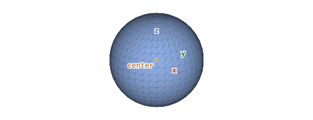
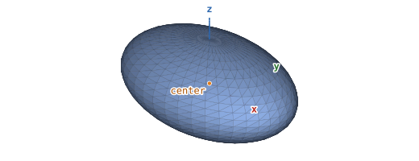
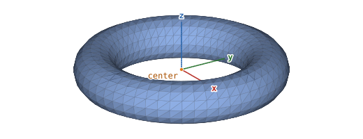
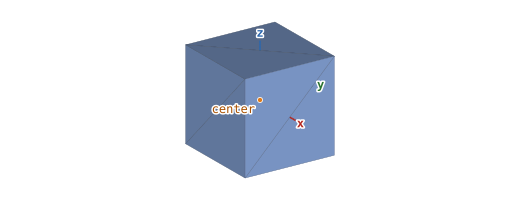
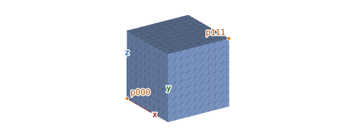
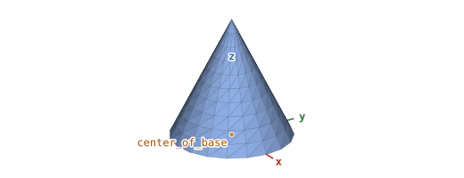
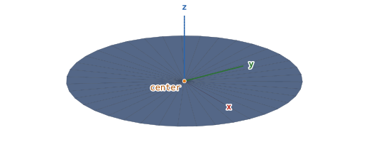
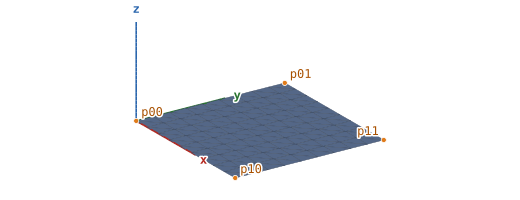
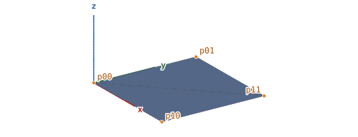
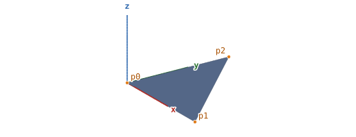

# Create basic shapes (mesh primitives)

**Goal**: pick the `mesh_primitive_*` function that builds the shape you need, know what its
parameters mean, and display all of them side by side.

> **Starting point**: the default project template (`src/scene.hpp`, `src/scene.cpp`, see
> [Your first scene](../get-started/first-scene.md)). It already declares the shapes `sphere`
> and `cylinder`, a `timer`, and the members `camera_control`, `environment` and `gui`: reuse
> them, do not declare them again. The first comment of each code block says in which file
> and where its lines go: *add* means insert them, *replace* means replace the whole function by the one shown.

<!-- demo: create-basic-shapes -->

## What a primitive gives you

Every `mesh_primitive_*` function returns a `mesh` on the CPU, with all its per-vertex arrays
filled: positions, normals, uv coordinates, white colors and triangles. Upload it once with
`initialize_data_on_gpu`, as for any mesh (see [Draw a mesh with a camera](draw-a-mesh.md)):

```cpp
// scene.hpp - add in scene_structure
mesh_drawable cone;
```

```cpp
// scene.cpp - add at the end of initialize()
cone.initialize_data_on_gpu(mesh_primitive_cone(0.3f, 0.8f, {0,0,0.6f}));   // radius, height, center of the base
cone.material.color = {1.0f, 0.6f, 0.2f};
```

All parameters have default values, so `mesh_primitive_sphere()` alone is a valid call. The
shape is built **in world units around the points you give**: move it later with
`model.translation` rather than rebuilding it (see [Move, rotate and scale a shape](transform-a-shape.md)).

**Sampling parameters.** *Nu*, *Nv* (or *N*) are numbers of vertices along the two directions
of the surface. More samples give a smoother shape and more triangles; the sphere has
40 x 20 samples by default.

In the pictures below, each shape is built with the call written under it (default
values), seen from the direction of the template camera. The edges of the triangles show the
sampling, the orange points are the points given as parameters, and the axes x (red),
y (green) and z (blue) start at the origin, with a length of 0.6.

## Curved closed shapes

### Sphere

```cpp
mesh mesh_primitive_sphere(float radius=1.0f, vec3 const& center={0,0,0}, int Nu=40, int Nv=20);
```



*Nu* samples go around the z axis (longitude), *Nv* from the south pole to the north pole
(latitude), plus one vertex per triangle at each pole. The uv coordinates follow these two
angles, so a texture wraps around the sphere once.

### Ellipsoid

```cpp
mesh mesh_primitive_ellipsoid(vec3 scale=vec3{1.0f, 1.0f, 1.0f}, vec3 const& center={0,0,0}, int Nu=40, int Nv=20);
```



A sphere of radius 1 stretched by `scale` along x, y and z: `scale` holds the three semi-axes.
With the default `{1,1,1}` it is a unit sphere. The normals are computed for the stretched
shape (not just scaled), so the lighting is correct.

### Torus

```cpp
mesh mesh_primitive_torus(float r_max=1.0f, float r_min=0.25f, vec3 const& center={0,0,0}, vec3 const& axis_orientation={0,0,1}, int Nu=55, int Nv=15);
```



*r_max* is the radius of the ring (from the center to the middle of the tube), *r_min* the
radius of the tube. The ring turns around *axis_orientation* (z by default). *Nu* samples go
around the ring, *Nv* around the tube.

## Boxes

### Cube

```cpp
mesh mesh_primitive_cube(vec3 const& center={0,0,0}, float edge_length=1.0f);
```



Six faces of two triangles, each face with its own four vertices (24 vertices): the normals
are not averaged across the edges, so the cube looks sharp. The faces are aligned with the
axes; turn the cube with `model.rotation`.

### Cubic grid

```cpp
mesh mesh_primitive_cubic_grid(vec3 const& p000={0,0,0}, vec3 const& p100={1,0,0}, vec3 const& p110={1,1,0}, vec3 const& p010={0,1,0},
                               vec3 const& p001={0,0,1}, vec3 const& p101={1,0,1}, vec3 const& p111={1,1,1}, vec3 const& p011={0,1,1},
                               int Nx=10, int Ny=10, int Nz=10);
```



A box given by its eight corners (*pXYZ* is the corner at x = X, y = Y, z = Z for a unit
cube), whose faces are regular grids with *Nx*, *Ny*, *Nz* samples along x, y and z. Use it
instead of `mesh_primitive_cube` when the vertices must move (deformation, displacement): the
cube has no vertex inside its faces. Moving the corners gives any hexahedron.

## Shapes along an axis

### Cylinder

```cpp
mesh mesh_primitive_cylinder(float radius=0.2f, vec3 const& p0={0,0,0}, vec3 const& p1={0,0,1}, int Nu=10, int Nv=20, bool is_closed=false);
```


The axis goes from *p0* to *p1* (any direction). *Nu* samples go **along the axis**, *Nv*
**around** it. By default the cylinder is open: the inside is visible through the ends, and
dark because it is lit from the back. `is_closed=true` adds a disc at each end. *p0* and *p1*
must differ (`Cylinder has 0 length` otherwise).

### Cone

```cpp
mesh mesh_primitive_cone(float radius=0.5f, float height=1.0f, vec3 const& center_of_base={0,0,0}, vec3 const& axis_direction={0,0,1}, bool is_closed_base=true, int Nu=20, int Nv=10);
```



The base is a circle of *radius* centered at *center_of_base*, the apex is at `height` along
*axis_direction*. Watch the order of the samples: for the cone, *Nu* goes **around** the axis
and *Nv* **along** the height, the opposite of the cylinder. The base is closed by a disc by
default.

### Arrow

```cpp
mesh mesh_primitive_arrow(vec3 const& p0={0,0,0}, vec3 const& p1={1,0,0}, float cylinder_radius=0.05f, float cone_height_scale=4.0f, float cone_radius_scale=2.5f, int N=18);
```


A cylinder ended by a cone, from *p0* to the tip at *p1*. The size of the cone is relative to
the radius of the cylinder: length `cone_height_scale * cylinder_radius`, radius
`cone_radius_scale * cylinder_radius`. The arrow must be longer than its cone
(`Too short arrow` otherwise): for a short arrow, reduce *cylinder_radius*.

### Coordinate frame

```cpp
mesh mesh_primitive_frame(frame const& f=frame(), float scale=1.0f, vec3 const& color_ux={1,0,0}, vec3 const& color_uy={0,1,0}, vec3 const& color_uz={0,0,1},
                          vec3 const& color_sphere={1,1,1}, float frame_thickness=0.025f);
```


Three arrows along the axes of the `frame` f (the world axes by default) and a sphere at its
origin. This is the `global_frame` of the template. The colors are **per-vertex colors**
(`mesh.color`), multiplied by `material.color`: keep the material white to see them (see
[Change the color of a shape](change-the-color.md)).

## Flat shapes

### Disc

```cpp
mesh mesh_primitive_disc(float radius=1.0f, vec3 const& center={0,0,0}, vec3 const& normal={0,0,1}, int N=40);
```



A fan of triangles from the `center` to *N* vertices on the circle (the first and the last are
at the same place), in the plane orthogonal to `normal`. All the normals are equal to
`normal`: the other side is dark.

### Grid

```cpp
mesh mesh_primitive_grid(vec3 const& p00={0,0,0}, vec3 const& p10={1,0,0}, vec3 const& p11={1,1,0}, vec3 const& p01={0,1,0}, int Nu=10, int Nv=10);
```



A surface sampled as a regular grid of *Nu* x *Nv* vertices between four corners (bilinear
interpolation: the corners need not be in a plane). The vertex at the sample `(ku, kv)` is
`position[kv + Nv * ku]`, with uv `(ku/(Nu-1), kv/(Nv-1))`. This is the starting point of
terrains and deformable surfaces: change the positions, then `normal_update()` (see
[Update a mesh at every frame](update-a-mesh-every-frame.md)).

### Quadrangle

```cpp
mesh mesh_primitive_quadrangle(vec3 const& p00={0,0,0}, vec3 const& p10={1,0,0}, vec3 const& p11={1,1,0}, vec3 const& p01={0,1,0});
```



Four vertices and two triangles `(p00, p10, p11)` and `(p00, p11, p01)`, with uv `(0,0)`,
`(1,0)`, `(1,1)`, `(0,1)` at the corners: the usual support of an image (billboard, screen
quad). Give the corners counter-clockwise when seen from the side that must be lit.

### Triangle

```cpp
mesh mesh_primitive_triangle(vec3 const& p0={0,0,0}, vec3 const& p1={1,0,0}, vec3 const& p2={0,1,0});
```



One triangle, with the normal `normalize(cross(p1-p0, p2-p0))` on its three vertices.

### Tetrahedron

```cpp
mesh mesh_primitive_tetrahedron(vec3 const& p0={0,0,0}, vec3 const& p1={1,0,0}, vec3 const& p2={0,1,0}, vec3 const& p3={0,0,1});
```


Four triangles, each with its own three vertices (flat faces). The default corners give
outward normals; with other corners, keep *p3* on the side where `cross(p1-p0, p2-p0)` points,
or the faces are inside out.

## Display all of them side by side

The demo at the top of this page runs the code below: one `mesh_drawable` per primitive,
in a grid of five columns. From left to right and from the back row to the front row:
sphere, ellipsoid, cube, cubic grid, closed cylinder; cone, torus, disc, grid, quadrangle;
triangle, tetrahedron, arrow, frame. The sizes are chosen so that every shape fits in a
cell of side 1.6 centered on its position.

```cpp
// scene.hpp - add in scene_structure
std::vector<mesh_drawable> primitives;
```

```cpp
// scene.cpp - add at the end of initialize()
std::vector<mesh> const shapes = {
    mesh_primitive_sphere(0.5f),
    mesh_primitive_ellipsoid({0.6f, 0.4f, 0.3f}),
    mesh_primitive_cube({0,0,0}, 0.8f),
    mesh_primitive_cubic_grid().centered(),                 // unit cube moved to the origin
    mesh_primitive_cylinder(0.25f, {0,0,-0.5f}, {0,0,0.5f}, 10, 20, true),
    mesh_primitive_cone(0.4f, 1.0f, {0,0,-0.5f}),
    mesh_primitive_torus(0.45f, 0.15f),
    mesh_primitive_disc(0.5f),
    mesh_primitive_grid({-0.5f,-0.5f,0}, {0.5f,-0.5f,0}, {0.5f,0.5f,0}, {-0.5f,0.5f,0}),
    mesh_primitive_quadrangle({-0.5f,-0.5f,0}, {0.5f,-0.5f,0}, {0.5f,0.5f,0}, {-0.5f,0.5f,0}),
    mesh_primitive_triangle({-0.5f,-0.5f,0}, {0.5f,-0.5f,0}, {0,0.5f,0}),
    mesh_primitive_tetrahedron({-0.4f,-0.4f,-0.4f}, {0.5f,-0.4f,-0.4f}, {-0.4f,0.5f,-0.4f}, {-0.4f,-0.4f,0.5f}),
    mesh_primitive_arrow({-0.5f,0,0}, {0.5f,0,0}),
    mesh_primitive_frame(frame(), 0.5f)
};
for (size_t k = 0; k < shapes.size(); ++k) {
    mesh_drawable drawable;
    drawable.initialize_data_on_gpu(shapes[k]);
    drawable.model.translation = {1.6f * (k % 5) - 3.2f, 1.6f - 1.6f * (k / 5), 0.0f};
    if (k < 13)
        drawable.material.color = {0.6f, 0.75f, 1.0f};   // the frame keeps its per-vertex colors
    primitives.push_back(drawable);
}
gui.display_frame = false;   // the world frame would hide the shape at the center
```

```cpp
// scene.cpp - replace the camera_control.look_at call in initialize()
camera_control.look_at({0.0f, -4.8f, 4.2f} /*eye*/, {0,-0.2f,0} /*target*/, {0,0,1});
```

Draw them instead of the template sphere and cylinder:

```cpp
// scene.cpp - replace display_frame()
void scene_structure::display_frame()
{
    environment.camera_view = camera_control.camera().matrix_view();
    environment.light = camera_control.camera_model.position();

    if (gui.display_frame)
        draw(global_frame, environment);

    for (mesh_drawable const& shape : primitives)
        draw(shape, environment);

    timer.update();
}
```

Copying a `mesh_drawable` into the vector copies the ids of its GPU buffers, not the buffers:
the copies share the data uploaded once by `initialize_data_on_gpu`.

## Common pitfalls

- **The shape looks faceted**: increase *Nu* / *Nv* (the cube, the quadrangle, the triangle
  and the tetrahedron are flat by construction).
- **One side of a flat shape (disc, grid, quadrangle) is dark**: its normals point to the
  other side. Swap two corners (or `flip_connectivity()` and negate the normals), or set
  `material.texture_settings.two_sided = true`.
- **The cone has too few samples around its axis**: *Nu* is around the axis for the cone
  but along the axis for the cylinder.
- **The program stops in `mesh_primitive_cylinder` or `mesh_primitive_arrow`**: a zero length
  axis, or an arrow shorter than its tip (see [Troubleshooting](../get-started/troubleshooting.md)).
- **A shape created in `display_frame()` makes the program slow**: build the mesh and call
  `initialize_data_on_gpu` once, in `initialize()`.

## Variations

- Combine primitives into one mesh: `mesh m = mesh_primitive_cylinder(...); m.push_back(mesh_primitive_sphere(...));`
  (one drawable, one draw call).
- Change the mesh before uploading it: `translate`, `scale`, `rotate`, `centered`,
  `normalize_size_to_position` are methods of `mesh`.
- Shapes made of several parts that move relative to each other: a [hierarchy](../understand/hierarchies.md).
- A shape no primitive gives: [Build a mesh by hand](build-a-mesh-by-hand.md),
  [mesh an implicit surface](mesh-an-implicit-surface.md) or [load an OBJ file](load-an-obj-file.md).

The figures of this page are drawn from the meshes built by the CGP functions themselves
(`tools/figures/primitives/` in the documentation sources).

## See also

- How-to: [Draw a mesh with a camera](draw-a-mesh.md), [Change the color of a shape](change-the-color.md), [Display the wireframe of a mesh](display-the-wireframe.md)
- Reference: [`mesh`](../reference/mesh.md) (all the `mesh_primitive_*` functions), [`frame`](../reference/frame.md)
