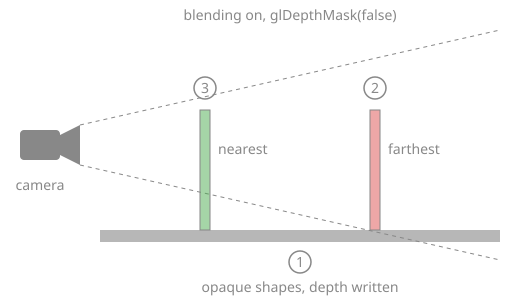

# Draw transparent objects

**Goal**: display a grass image and a colored window (PNG images with an alpha channel)
in front of each other without visual artifacts.

> **Starting point**: the default project template (`src/scene.hpp`, `src/scene.cpp`, see
> [Your first scene](../get-started/first-scene.md)). It already declares the shapes `sphere`
> and `cylinder`, a `timer`, and the members `camera_control`, `environment` and `gui`: reuse
> them, do not declare them again. The first comment of each code block says in which file
> and where its lines go: *add* means insert them, *replace* means replace the whole function by the one shown.

<!-- demo: draw-transparent-objects -->

## How transparency works

The default shader outputs an alpha value equal to `material.alpha` times the alpha of
the texture pixel. This value is ignored unless **blending** is enabled in OpenGL; then
the new color is mixed with the color already in the image:

```text
color = alpha * new_color + (1 - alpha) * previous_color
```

The result depends on what was drawn before, hence three rules: draw opaque shapes
first, do not write the depth of transparent shapes, and draw transparent shapes from
the farthest to the nearest.



## 1. Create the transparent shapes (once)

The two images are not in the template: download [grass.png](../assets/download/grass.png)
(670 KB) and [window_red.png](../assets/download/window_red.png) (10 KB), or use your own PNG
images with an alpha channel, saved in a folder `assets/` at the root of the project (next
to `shaders/`) as `assets/grass.png` and `assets/window_red.png`.

```cpp
// scene.hpp - add in scene_structure
mesh_drawable floor;
mesh_drawable quad_1;
mesh_drawable quad_2;
```

```cpp
// scene.cpp - add at the end of initialize()
floor.initialize_data_on_gpu(mesh_primitive_quadrangle({-1.5f,-1.5f,-0.5f}, {1.5f,-1.5f,-0.5f}, {1.5f,1.5f,-0.5f}, {-1.5f,1.5f,-0.5f}));

mesh quad_mesh = mesh_primitive_quadrangle({-0.5f,0,0}, {0.5f,0,0}, {0.5f,0,1}, {-0.5f,0,1});
quad_1.initialize_data_on_gpu(quad_mesh);
quad_2.initialize_data_on_gpu(quad_mesh);
quad_1.texture.load_and_initialize_texture_2d_on_gpu(project::path + "assets/grass.png");
quad_2.texture.load_and_initialize_texture_2d_on_gpu(project::path + "assets/window_red.png");
quad_1.model.translation = {0, -0.5f, -0.5f};   // standing on the floor, at z = -0.5
quad_2.model.translation = {0, +0.5f, -0.5f};
```

For a shape without texture, set `material.alpha` in `[0,1]` instead
(`1` = opaque, `0` = invisible).

## 2. Draw opaque shapes, then transparent ones (every frame)

The opaque shapes of the template (`global_frame`, `sphere`, `cylinder`) are drawn first, with the
floor. The whole function:

```cpp
// scene.cpp - replace display_frame()
void scene_structure::display_frame()
{
    environment.camera_view = camera_control.camera().matrix_view();
    environment.light = camera_control.camera_model.position();

    // 1. all opaque shapes first
    if (gui.display_frame)
        draw(global_frame, environment);
    draw(sphere, environment);
    cylinder.model.rotation = rotation_transform::from_axis_angle({1,0,0}, timer.t);
    draw(cylinder, environment);
    draw(floor, environment);

    glEnable(GL_BLEND);              // 2. enable blending
    glBlendFunc(GL_SRC_ALPHA, GL_ONE_MINUS_SRC_ALPHA);
    glDepthMask(false);              //    keep testing depth, but do not write it

    // 3. sort by depth: draw the farthest quad first
    mat4 const T = camera_projection.matrix() * camera_control.camera_model.matrix_view();
    vec4 const p1 = T * vec4{0, -0.5f, 0, 1};    // centers of the quads
    vec4 const p2 = T * vec4{0, +0.5f, 0, 1};
    if (p1.z / p1.w <= p2.z / p2.w) {            // quad_1 is nearer
        draw(quad_2, environment);
        draw(quad_1, environment);
    } else {
        draw(quad_1, environment);
        draw(quad_2, environment);
    }

    glDepthMask(true);               // 4. restore the default state
    glDisable(GL_BLEND);

    timer.update();
}
```

`glEnable`, `glBlendFunc` and `glDepthMask` are plain OpenGL calls, available in the scene
code through the CGP header.

## Common pitfalls

- **Transparent pixels appear black or white**: blending is not enabled, or the image
  has no alpha channel (JPEG never has one: use PNG).
- **An object behind a transparent quad disappears**: the transparent quad was drawn
  before it and wrote its depth. Draw opaque shapes first, and disable depth writing
  (`glDepthMask(false)`) for transparent ones.
- **Two transparent shapes flicker or hide each other depending on the view**: they are
  not sorted. Sort them by depth at every frame (with many objects: compute the depth of
  each center, `std::sort`, then draw).
- **The whole scene becomes transparent or loses depth**: `glDepthMask(true)` and
  `glDisable(GL_BLEND)` were not restored after drawing the transparent shapes.

## Variations

- Make a quad always face the camera (billboard):
  `quad_1.model.rotation = camera_control.camera_model.orientation();`.
- Billboard that stays vertical (trees, grass): rotate around z only, using the right
  vector of the camera,
  `rotation_transform::from_frame_transform({1,0,0}, {0,0,1}, camera_control.camera_model.right(), {0,0,1})`.
- Fade out an object with time: `quad_1.material.alpha = 1 - t / duration;`.
- Cut-out without blending (fully opaque or fully transparent pixels, no sorting needed):
  `discard` the fragment in a custom fragment shader when the alpha is below 0.5.

Source: course labs of CSC_43043 ([public version](https://github.com/drohmer/csc43043ep-lab-code), without the solutions): [`07_texture/b_billboards`](https://github.com/drohmer/csc43043ep-lab-code/tree/main/07_texture/b_billboards) (scene.cpp, display_semiTransparent), and
[`07_texture/d_animation`](https://github.com/drohmer/csc43043ep-lab-code/tree/main/07_texture/d_animation) (fading smoke billboards with `material.alpha`).

## See also

- How-to: [Apply a texture image](apply-a-texture.md), [Spawn objects periodically](spawn-objects-periodically.md)
- Understand: [Camera and matrices](../understand/camera-and-matrices.md)
- Reference: [`mesh_drawable`](../reference/mesh_drawable.md), [`rotation_transform`](../reference/rotation_transform.md), [`camera_projection_perspective`](../reference/camera_projection_perspective.md)
