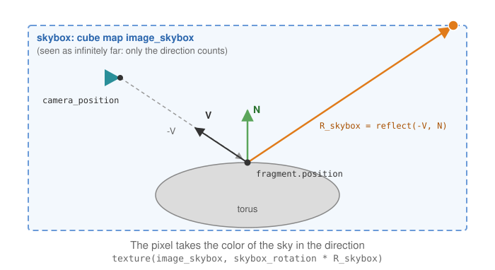

# Reflect the environment on a shape

**Goal**: display a chrome-like torus that reflects the sky around it.

> **Starting point**: the default project template (`src/scene.hpp`, `src/scene.cpp`, see
> [Your first scene](../get-started/first-scene.md)). It already declares the shapes `sphere`
> and `cylinder`, a `timer`, and the members `camera_control`, `environment` and `gui`: reuse
> them, do not declare them again. The first comment of each code block says in which file
> and where its lines go: *add* means insert them, *replace* means replace the whole function by the one shown.

<!-- demo: reflect-the-environment -->

## How it works

For each pixel of the shape, the fragment shader computes the direction from the camera
to the surface, reflects it around the normal, and reads the color of the skybox in that
direction. The shader therefore needs a second texture, the cube map of the skybox. A
`mesh_drawable` can carry extra textures in its `supplementary_texture` map: each entry
`name -> texture` is bound at `draw` time to the GLSL sampler of the same name.



This page starts from the template **with a skybox** already set up as in
[Add a skybox](add-a-skybox.md) (the member skybox, drawn first in `display_frame()`).

## 1. Write the fragment shader

Copy `shaders/mesh/mesh.frag.glsl` to `shaders/environment_map/environment_map.frag.glsl`
(create the folder `shaders/environment_map/`)
and add the reflection (the vertex shader stays the default one):

```glsl
// shaders/environment_map/environment_map.frag.glsl (only the changed lines)
uniform samplerCube image_skybox;   // the cube map, sent as a supplementary texture
uniform mat3 skybox_rotation;       // same rotation as the skybox

void main()
{
    // ... default code computing camera_position, N (normal) and L ...

    // V, unit vector toward the camera: declared inside the "if" of the specular
    // component in the default shader, move this line before the "if"
    vec3 V = normalize(camera_position - fragment.position);

    // ... default code computing the diffuse and specular components, color_image_texture ...

    vec3 R_skybox = reflect(-V, N);
    vec4 color_environment_map = texture(image_skybox, skybox_rotation * R_skybox);

    vec3 color_object = fragment.color * material.color * color_image_texture.rgb * color_environment_map.rgb;
    // ... rest of the default shader unchanged
}
```

## 2. Load the shader and attach the cube map (once)

```cpp
// scene.hpp - add in scene_structure
mesh_drawable torus;
uniform_generic_structure uniforms_reflection;
```

```cpp
// scene.cpp - add at the end of initialize(), after the creation of the skybox
torus.initialize_data_on_gpu(mesh_primitive_torus());
torus.model.translation = {0, 0, 1.0f};   // above the sphere and the cylinder of the template
torus.shader.load(
    project::path + "shaders/mesh/mesh.vert.glsl",
    project::path + "shaders/environment_map/environment_map.frag.glsl");

torus.supplementary_texture["image_skybox"] = skybox.texture;     // name of the GLSL sampler
uniforms_reflection.uniform_mat3["skybox_rotation"] = skybox.skybox_rotation;
```

## 3. Draw (every frame)

The skybox is already drawn first (see [Add a skybox](add-a-skybox.md)); add the torus
after it:

```cpp
// scene.cpp - add in display_frame(), before timer.update()
draw(torus, environment, 1, true, uniforms_reflection);   // extra uniforms for this shape only
```

The arguments after `environment` are the number of instances (1), *expected_uniforms*
(*true*: warn if the shader does not use a uniform) and *additional_uniforms*; this fifth
argument sends the extra uniforms to the torus only: the other
shapes, which use the default shader, do not receive `skybox_rotation`.

## Common pitfalls

- **The torus is black**: the cube map is not bound (the key of `supplementary_texture`
  differs from the name of the sampler in GLSL), or the rotation matrix was never sent (an
  unset uniform matrix is zero, and so is the direction read in the cube map).
- **The reflection does not match the sky**: the shader does not apply the same rotation
  as the skybox. Send `skybox.skybox_rotation`, after it has been set.
- **The reflection is mirrored or does not move with the camera**: V must go from the
  surface toward the camera, and both N and V must be in world space (the default shader
  computes them so).
- **Warning about an unused uniform on every shape**: the rotation was put in
  `environment.uniform_generic`, which is sent to all shapes. Use the per-draw uniforms as
  above, or set `environment.default_expected_uniform = false;` (it silences these
  warnings for all environments).

## Variations

- Metallic tint: keep `material.color` to tint the reflection, and lower the diffuse
  coefficient: `torus.material.phong.diffuse = 0.2f;`.
- Combine two ordinary textures (brick image darkened by cracks): load the second one
  directly into the map,
  `wall.supplementary_texture["image_texture_2"].load_and_initialize_texture_2d_on_gpu(project::path + "assets/crack.png");`,
  declare `uniform sampler2D image_texture_2;` in the fragment shader and multiply the two
  colors read from the textures.
- Refraction (glass): in the shader, replace the call reflect(-V, N) by
  refract(-V, N, 1.0/1.5) (ratio of the refraction indices of air and glass).

Source: EPITA Ani3D repository `epita_ani3d_lab_code-2027`, examples
`05_environment_map/02_environment_map` (scene.cpp, environment_map.frag.glsl) and
`03_shaders/02_multi_texture` (scene.cpp, mesh_multi_texture.frag.glsl). Adaptation: the
example sends the rotation through `environment.uniform_generic` and disables the uniform
warnings globally; this page uses the per-draw uniforms of `draw`.

## See also

- How-to: [Add a skybox](add-a-skybox.md), [Send a custom uniform to a shader](send-a-custom-uniform.md), [Apply a texture image](apply-a-texture.md)
- Understand: [Shaders and uniforms](../understand/shaders-and-uniforms.md)
- Reference: [`mesh_drawable`](../reference/mesh_drawable.md), [`opengl_texture_image_structure`](../reference/opengl_texture_image_structure.md), [`opengl_shader_structure`](../reference/opengl_shader_structure.md)
