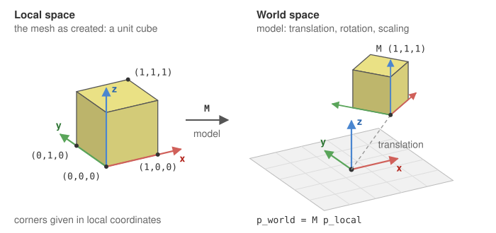
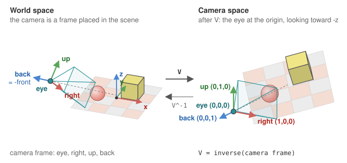

# Camera and matrices

Every vertex you draw goes through the same chain of transformations before it lands on the
screen. CGP computes three 4x4 matrices on the CPU (`mat4`) and sends them to the GPU as
[*uniform variables*](glossary.md#uniform); the [vertex shader](glossary.md#vertex-shader) multiplies them with each vertex position.

$$
p_{\text{clip}} = \underbrace{P}_{\text{projection}}\;\underbrace{V}_{\text{view}}\;\underbrace{M}_{\text{model}}\; p_{\text{local}}
$$

The result is in [*clip space*](glossary.md#clip-space), a 4D homogeneous point $(x, y, z, w)$. The GPU then divides
it by its fourth coordinate to get the [*normalized device coordinates*](glossary.md#ndc) (NDC),
$p_{\text{NDC}} = (x/w,\; y/w,\; z/w)$, in $[-1,1]^3$ for the visible points, and finally
maps $x_{\text{NDC}}, y_{\text{NDC}}$ to the pixels of the window.

| Matrix | Moves from | To | Set in CGP by |
|---|---|---|---|
| Model $M$ | local coordinates of the shape | world coordinates | `mesh_drawable::model` |
| View $V$ | world coordinates | camera coordinates | `camera.matrix_view()` |
| Projection $P$ | camera coordinates | clip space (NDC after the division by $w$) | `camera_projection_perspective::matrix()` |


All coordinates are [*homogeneous*](glossary.md#homogeneous-coordinates): a 3D point $(x,y,z)$ is stored as $(x,y,z,1)$ so that
translations and perspective can be written as matrix products.

## 1. Model matrix: placing the shape in the world

A [mesh](glossary.md#mesh) is defined once in its own local [frame](glossary.md#frame) (for instance a unit cube or a sphere centered at
the origin). The model matrix places, orients and scales this shape in the scene.



In CGP each `mesh_drawable` has a `model` field (an `affine` [transform](glossary.md#affine-transform)) that you set directly:

```cpp
sphere.model.translation = {-0.5f, 0.75f, 0.0f};
sphere.model.rotation = rotation_transform::from_axis_angle({1,0,0}, 3.14f/4);
sphere.model.scaling = 0.5f;
```

The model matrix actually sent to the shader also includes two terms that are identity
unless you use a hierarchy or set a custom matrix: see
[the model matrix of a drawable](transformations.md#6-to-mat4-and-the-model-matrix-of-a-drawable).

## 2. View matrix: looking from the camera

The camera is itself a frame in the world: a position (the *eye*) and three axes
(*right*, *up*, *back*). The view matrix is the **inverse** of this camera frame: it expresses
every world point in the camera coordinates, where the camera sits at the origin and looks
towards $-z$.



$$
V = \begin{pmatrix} R^T & -R^T e \\ 0 & 1 \end{pmatrix}
\qquad R = [\,\text{right}\;|\;\text{up}\;|\;\text{back}\,],\; e = \text{eye position}
$$

In CGP the camera model computes it for you (`matrix_view()` returns
`inverse(to_frame()).matrix()`), and the scene updates it at every frame:

```cpp
environment.camera_view = camera_control.camera().matrix_view();
```

The [camera controller](glossary.md#camera-controller) (orbit, first person, fly mode...) only changes the camera frame from
mouse and keyboard inputs; the view matrix follows.

## 3. Projection matrix: from 3D to the screen

The perspective projection, followed by the division by $w$, maps the visible pyramid in
front of the camera (the *frustum*, between the near and far planes) onto the cube
$[-1,1]^3$ of the *normalized device coordinates*. Points outside this cube are clipped.

![The perspective projection P, followed by the division by w, maps the frustum of camera space, between the near plane z = -n and the far plane z = -f, onto the NDC cube [-1,1]^3; each corner keeps its color, the near plane goes to z = -1 and the far plane to z = 1.](../assets/frustum.svg)

With a vertical field of view $\theta$, an aspect ratio $a$ (width / height) and near / far
distances $n, f$:

$$
P = \begin{pmatrix}
\frac{f_y}{a} & 0 & 0 & 0 \\
0 & f_y & 0 & 0 \\
0 & 0 & \frac{f+n}{n-f} & \frac{2fn}{n-f} \\
0 & 0 & -1 & 0
\end{pmatrix}
\qquad f_y = \frac{1}{\tan(\theta/2)}
$$

The last row copies $-z$ into the fourth coordinate $w$. The GPU then divides by $w$: this
*perspective division* is what makes distant objects smaller.

![After the division by w, visible points lie in the cube [-1,1]^3; the viewport maps x and y to the pixels of the window, from (0,0) at the bottom left to (width, height), and z is kept in the depth buffer.](../assets/ndc.svg)

In CGP the parameters live in `camera_projection_perspective` (`field_of_view`, `aspect_ratio`,
`depth_min`, `depth_max`). The application rebuilds the matrix at every frame, before
calling `display_frame()`, so that it follows the size of the window (in
`src/application.cpp`, function `animation_loop`):

```cpp
s.camera_projection.aspect_ratio = s.window.aspect_ratio();   // s: the scene
s.environment.camera_projection = s.camera_projection.matrix(); // calls projection_perspective(...)
```

<!-- demo: projection -->
> **Try it.** The interactive demo above is a CGP program of the course CSC_43043: move the
> camera and change the field of view to see the frustum and its image in NDC.

## 4. From CGP to the GPU: uniform variables

A *uniform* is a shader variable whose value is the same for every vertex of a draw call. The
default CGP vertex shader declares the three matrices:

```glsl
uniform mat4 model;      // shape -> world
uniform mat4 view;       // world -> camera
uniform mat4 projection; // camera -> clip space (NDC after the division by w)

void main() {
    vec4 position = model * vec4(vertex_position, 1.0);
    gl_Position = projection * view * position;
}
```

When you call `draw(drawable, environment)`, CGP sends them before issuing the draw command:
`model` comes from the drawable, `view` and `projection` from the environment. Who sends which
uniform, in which order, and how to send your own values is explained once, in
[Shaders and uniforms](shaders-and-uniforms.md#3-three-levels-of-uniforms).


## See also

- How-to: [Draw a mesh with a camera](../how-to/draw-a-mesh.md)
- Reference: [`mat4`](../reference/mat4.md), [`vec3`](../reference/vec3.md), `projection_perspective`, `opengl_uniform`
