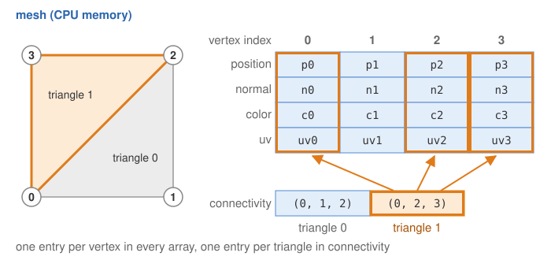
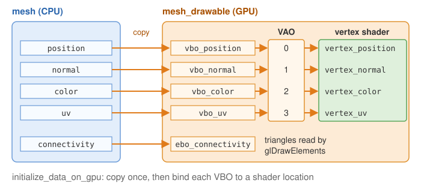
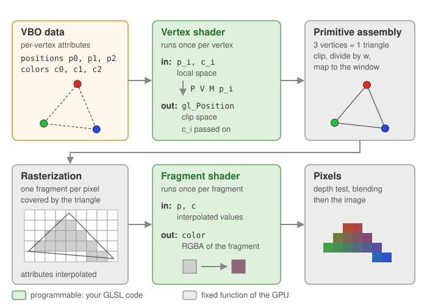
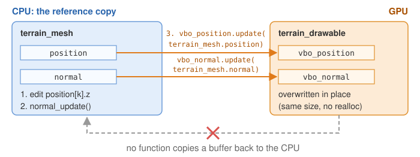
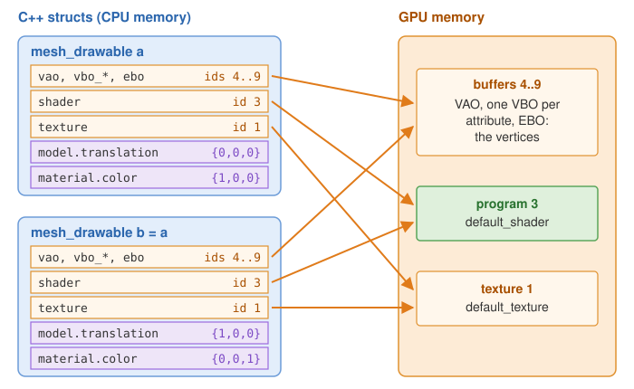

# From CPU to GPU

Your C++ code runs on the **CPU** and stores its data in the main memory (RAM). The images are
computed by the **GPU**, which has its own memory and runs the [shaders](glossary.md#shader) in parallel on every
vertex and every pixel. Before anything can be drawn, the data must be **copied** from the CPU
memory to the GPU memory. CGP makes this copy explicit with two different types:

| | `mesh` | `mesh_drawable` |
|---|---|---|
| Lives in | CPU memory | GPU memory (the struct only stores OpenGL ids) |
| Contains | arrays `position`, `normal`, `color`, `uv`, `connectivity` | VBOs, EBO, VAO, shader, texture, `model`, `material` |
| You can | read and modify every vertex in C++ | draw it with `draw(drawable, environment)` |
| You cannot | draw it directly | read its vertices back in C++ |


## 1. mesh: data on the CPU

A `mesh` is a plain container of per-vertex arrays plus the triangles:

```cpp
struct mesh {
    numarray<vec3> position;      // one entry per vertex
    numarray<vec3> normal;
    numarray<vec3> color;
    numarray<vec2> uv;
    numarray<uint3> connectivity; // one entry per triangle: 3 vertex indices
    // + helper functions: fill_empty_field(), normal_update(), translate(), ...
};
```



You get one from a primitive (`mesh_primitive_sphere`, `mesh_primitive_grid`...), from a file
(`mesh_load_file_obj`), or by filling the arrays yourself. All per-vertex arrays must have the
same size: if you build a mesh by hand with positions and connectivity only, call
`fill_empty_field()` to fill normals, colors (white) and uv (zero) before sending it to the
GPU. Otherwise `mesh_check` reports the missing buffers and the program stops.

## 2. mesh_drawable: buffers on the GPU

A `mesh_drawable` is what the GPU needs to draw a shape. Its members, from the header:

| Member | What it is |
|---|---|
| `vbo_position`, `vbo_normal`, `vbo_color`, `vbo_uv` | one [*Vertex Buffer Object*](glossary.md#vbo) per [attribute](glossary.md#attribute): a GPU array, identified by an id |
| `ebo_connectivity` | the [*Element Buffer Object*](glossary.md#ebo): the triangle indices |
| `vao` | the [*Vertex Array Object*](glossary.md#vao): tells the GPU how to read the VBOs (which buffer goes to which shader input) |
| `shader` | the GPU program used to draw (`default_shader` unless you set another one) |
| `texture` | the image ([texture](glossary.md#texture)) applied on the surface (`default_texture`, a 1x1 white image, unless set) |
| `model` | the transform placing the shape in the world (sent as a [uniform](glossary.md#uniform)) |
| `material` | color, transparency, [Phong](glossary.md#phong-shading) coefficients, texture settings (sent as uniforms) |

The buffer structures (`opengl_vbo_structure`, `opengl_ebo_structure`) store only the OpenGL
`id`, the number of elements `size`, and the memory layout. **There is no copy of the vertex
positions inside a `mesh_drawable`.**

## 3. initialize_data_on_gpu: the copy

```cpp
mesh sphere_mesh = mesh_primitive_sphere(0.25f);   // CPU
sphere.initialize_data_on_gpu(sphere_mesh);         // CPU -> GPU
sphere.model.translation = {-0.5f, 0.75f, 0.0f};    // uniforms: set after the initialization
sphere.material.color = {1.0f, 0.0f, 0.0f};
```

`mesh_drawable::initialize_data_on_gpu` does:

1. checks the mesh (`mesh_check`): non-empty, all arrays of the same size, valid indices;
2. sets `shader` and `texture` (the default ones, unless given as arguments or already set);
3. **resets** `model`, `material` and `supplementary_model_matrix` to their default values;
4. creates the four VBOs and the EBO: each one calls `glBufferData`, which allocates GPU memory
   and copies the array into it;
5. creates the VAO and binds each VBO to a fixed *location* of the shader input:
   position -> 0, normal -> 1, color -> 2, uv -> 3.



Consequences:

- Set `model` and `material` **after** `initialize_data_on_gpu`, or they are overwritten.
- Call it **once**, in `initialize()`. Calling it again on a drawable that already has buffers
  prints a warning: the previous GPU memory is lost (call `clear()` first if you really want to
  rebuild the drawable). Never call it in `display_frame`: it would allocate new GPU memory at
  every frame.
- The `mesh` can be a temporary: once copied, the drawable no longer needs it. Keep it as a
  member of the scene only if you want to modify it later (next section).
- Copying a `mesh_drawable` (`cube2 = cube1`) copies the ids, not the buffers: both drawables
  share the same GPU data but have their own `model` and `material`. This is how you draw the
  same shape many times at different positions; see
  [Copies, sharing and freeing](#7-copies-sharing-and-freeing) for what the copies share.

At each frame, `draw` only sends the uniforms, binds the VAO and the texture and issues one
`glDrawElements`: no vertex data travels from the CPU to the GPU.



## 4. Updating the buffers

To animate the *shape* (not just its position), modify the CPU mesh, then overwrite the
content of the existing VBOs with `opengl_vbo_structure::update`. This is the pattern of the
Perlin noise terrain of the course:

```cpp
// scene.hpp: keep both
mesh terrain_mesh;
mesh_drawable terrain_drawable;

// when a parameter changes
for (int k = 0; k < terrain_mesh.position.size(); ++k)
    terrain_mesh.position[k].z = height(terrain_mesh.position[k]);  // 1. modify on the CPU
terrain_mesh.normal_update();                                       // 2. recompute normals
terrain_drawable.vbo_position.update(terrain_mesh.position);        // 3. copy to the GPU
terrain_drawable.vbo_normal.update(terrain_mesh.normal);
```



- `update` calls `glBufferSubData`: it rewrites the buffer **without reallocating** it. The
  new array cannot be larger than the one used at the initialization (CGP stops with an error
  otherwise); to change the number of vertices or triangles, `clear()` and initialize again.
- Moving vertices changes the normals: call `mesh::normal_update` (recomputes per-vertex
  normals from the triangles) and update `vbo_normal` too, otherwise the lighting stays the
  one of the old shape.
- Only update the buffers that changed (positions and normals, here; colors if you edit them).
- If only the position, rotation or scale of a rigid shape changes, do **not** touch the
  buffers: change `model`, which is a uniform and costs nothing to update.

Extra per-vertex or per-instance arrays can be attached at locations 4 and above with
`initialize_supplementary_data_on_gpu(data, location)` and updated with
`update_supplementary_data_on_gpu`.

## 5. Textures: from an image on the CPU to a texture on the GPU

Textures follow the same pattern. An image is first a CPU array (an `image_structure`
loaded from a .png/.jpg file, or a `grid_2D<vec3>` of colors you compute); it is then copied
into an OpenGL texture held by an `opengl_texture_image_structure`, which again only stores
an `id`, the size and the format.

```cpp
// load a file and send it to the GPU in one call
ground.texture.load_and_initialize_texture_2d_on_gpu(project::path + "assets/checkerboard.png");

// or: compute a CPU image, then send it
grid_2D<vec3> img;  // filled by your code
quad.texture.initialize_texture_2d_on_gpu(img, GL_CLAMP_TO_EDGE, GL_CLAMP_TO_EDGE,
                                          false, GL_NEAREST, GL_NEAREST);
// at each frame, after modifying img on the CPU:
quad.texture.update(img);
```

- `initialize_texture_2d_on_gpu` allocates the texture and copies the pixels (and builds the
  [mipmaps](glossary.md#mipmap) unless the 4th argument is false); the wrap mode (`GL_CLAMP_TO_EDGE`, `GL_REPEAT`...) and
  the filters are chosen here.
- `opengl_texture_image_structure::update` overwrites the pixels of the existing texture
  (same size).
- The texture is read in the [fragment shader](glossary.md#fragment-shader) at the `uv` [coordinates](glossary.md#uv-coordinates) of the mesh. The image
  is flipped vertically by default (`material.texture_settings.inverse_v`, true by default).
- To go back to a plain color, set `material.texture_settings.active = false`.

## 6. Why the data cannot be read back

A `mesh_drawable` holds ids, not arrays: `sphere.vbo_position` has no `[k]` operator, and CGP
provides no function to copy a buffer or a texture back from the GPU to the CPU. This is
deliberate:

- the GPU works asynchronously; reading its memory forces the CPU to wait until all pending
  commands are finished, which ruins the frame rate;
- the useful data already exists on the CPU: you created it there.

So the rule is: **the CPU is the reference copy**. Keep the `mesh` (or the image) as a member
of the scene whenever you need to read or modify it later, apply your changes there, and send
them to the GPU with `update`. Likewise, what a vertex shader computes (for instance a wave
displacement in GLSL) exists only on the GPU, for the current frame: the C++ code cannot read
the displaced positions, e.g. for collisions.

## 7. Copies, sharing and freeing

A `mesh_drawable`, an `opengl_texture_image_structure` and an `opengl_shader_structure` are
*handles*: small C++ structs that hold the id of an OpenGL object. Copying the struct copies
the id, never the GPU object.

```cpp
mesh_drawable a;
a.initialize_data_on_gpu(mesh_primitive_cube());
mesh_drawable b = a;               // same buffers, same shader, same texture as a
b.model.translation = {1, 0, 0};   // only b moves
b.material.color = {0, 0, 1};      // only b turns blue
```



What an operation on *b* does to *a*:

| Operation on *b* | Effect on *a* | Why |
|---|---|---|
| change `b.model`, `b.material` | none | values stored in *b*, sent as uniforms at each `draw` |
| `b.shader = other_shader`, `b.texture = other_texture` | none | *b* now holds other ids; *a* keeps its own |
| `b.vbo_position.update(...)` | *a* changes shape too | one buffer for both |
| `b.texture.update(image)` | *a* changes too | one texture for both |
| `b.clear()` | *a* is broken | the buffers of *a* are deleted: *a* keeps ids that no longer exist, and drawing it is an OpenGL error |
| `b.shader.clear()` | every drawable using this program is broken | with the default shader, that is every shape of the scene |
| `b.texture.clear()` | every drawable using this texture is broken | the same for `default_texture` |

So, to give a copy its own shape, do not `clear()` it: start from an empty drawable,
`b = mesh_drawable();`, then `b.initialize_data_on_gpu(other_mesh)`. *a* keeps its buffers.

Freeing works on the same ids:

- `mesh_drawable::clear()` deletes the VAO, the VBOs and the EBO, and resets `shader`,
  `texture`, `model` and `material` in the struct. It does **not** delete the shader program
  nor the texture: they are usually shared (the default ones by all the drawables). Delete
  your own shader or texture once, with its own `clear()`, when no drawable uses it any more.
- These structs have no destructor: a drawable that goes out of scope leaves its buffers on
  the GPU until the program ends. Declare the drawables as members of the scene and
  initialize them once; never create one in `display_frame`.
- The same rules hold for the other drawables (`curve_drawable`, `triangles_drawable`...)
  and for the nodes of a `hierarchy_mesh_drawable`, which store copies of the drawables
  passed to `add`.

## See also

- [Scene structure](scene-structure.md): where `initialize` and `display_frame` are called.
- [Shaders and uniforms](shaders-and-uniforms.md): how the VBOs and uniforms are read on the GPU.
- How-to: [Draw a mesh with a camera](../how-to/draw-a-mesh.md)
- Course labs of CSC_43043 ([public version](https://github.com/drohmer/csc43043ep-lab-code), without the solutions):
  [`05_shaders/a_shader_manipulation`](https://github.com/drohmer/csc43043ep-lab-code/tree/main/05_shaders/a_shader_manipulation) (mesh vs mesh_drawable),
  [`07_texture/c_perlin_noise`](https://github.com/drohmer/csc43043ep-lab-code/tree/main/07_texture/c_perlin_noise) (buffer update), [`03_classes/c_dynamic_image`](https://github.com/drohmer/csc43043ep-lab-code/tree/main/03_classes/c_dynamic_image) (texture update).
