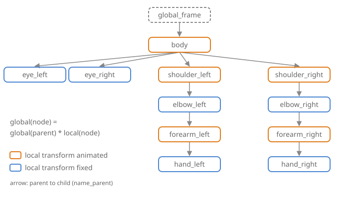

# Hierarchies of shapes

A character, a robot arm, a car with its wheels or a planet with its moon are made of
parts that move **together**: when the arm turns, the hand follows. Placing every part with
its own `model` works for a still image, but as soon as one part moves, you would have to
recompute the placement of every part attached to it.

A `hierarchy_mesh_drawable` stores the parts as a **tree**. Each node is placed relative to
its parent only, and CGP composes the transforms from the root to the leaves. To animate
the arm, you change one local transform, and the forearm and the hand follow.

## 1. Nodes and the tree

The two structs, from `cgp/16_drawable/hierarchy_mesh_drawable/hierarchy_mesh_drawable.hpp`:

```cpp
struct hierarchy_mesh_drawable_node {
    mesh_drawable drawable;                     // the shape (a copy)
    std::string name = "uninitialized";          // unique in the hierarchy
    std::string name_parent = "global_frame";   // the node it is attached to
    affine_rts transform_local;                  // placement in the frame of the parent
};

struct hierarchy_mesh_drawable {
    std::vector<hierarchy_mesh_drawable_node> elements;  // parents before their children
    std::map<std::string, int> name_map;                  // name -> index in elements
    // add, operator[], update_local_to_global_coordinates, hierarchy_display
};
```

The tree is not stored as pointers: each node only knows the **name** of its parent, and
`elements` keeps the nodes in the order they were added, every parent before its children.



## 2. Local and global transforms

`transform_local` is an `affine_rts` (rotation, translation, uniform scaling) expressed in
the frame of the parent. The **global** transform of a node, which places it in the world,
is the product along the path from the root:

$$
\text{global(node)} = \text{global(parent)} \; \text{local(node)}
\qquad
\text{global(root)} = \text{local(root)}
$$

Since the right factor of a product is applied first (see
[Rotations, frames and affine transforms](transformations.md)), a point of the node is
first placed in the frame of its parent, then the parent places it in the frame of the
grand-parent, and so on up to the world.


`update_local_to_global_coordinates()` computes all the global transforms in one pass over
`elements`. Since parents come first, the global transform of the parent is always ready
when its child is reached. The result is stored in each drawable, in
`mesh_drawable::hierarchy_transform_model`, and `draw(hierarchy, environment)` simply draws
every node: `draw` applies `hierarchy_transform_model` on top of the `model` of the drawable
(the full formula of the model matrix is in
[Rotations, frames and affine transforms](transformations.md#6-to-mat4-and-the-model-matrix-of-a-drawable)).

So each node has **two** transforms, with different roles:

| | `transform_local` (of the node) | `model` (of its drawable) |
|---|---|---|
| Type | `affine_rts` | `affine` |
| Passed to the children | yes | no |
| Use it for | the joints: what moves the part and everything attached to it | adjusting this shape alone: size, stretching (`scaling_xyz`), offset |

For example, `transform_local.scaling = 2` makes the node *and its children* twice as large
(and the children twice as far), whereas `drawable.model.scaling = 2` only enlarges this
one shape.

## 3. Building a hierarchy

`add` has three versions; all of them copy the drawable into a new node:

```cpp
void add(hierarchy_mesh_drawable_node const& node);
void add(mesh_drawable const& element, std::string const& name,
         std::string const& name_parent = "global_frame",
         vec3 const& translation = vec3(), rotation_transform const& = rotation_transform());
void add(mesh_drawable const& element, std::string const& name,
         std::string const& name_parent, affine_rts const& transform);
```

A small solar system, with the sun at the origin, the earth turning around it and the moon
turning around the earth. To try it, start from the default project template
(`src/scene.hpp`, `src/scene.cpp`, see [Your first scene](../get-started/first-scene.md)),
which already has a timer: do not declare a second one.

```cpp
// scene.hpp - add in scene_structure
hierarchy_mesh_drawable solar_system;
```

```cpp
// scene.cpp - add at the end of initialize()
mesh_drawable sun, earth, moon;
sun.initialize_data_on_gpu(mesh_primitive_sphere(0.5f));
earth.initialize_data_on_gpu(mesh_primitive_sphere(0.15f));
moon.initialize_data_on_gpu(mesh_primitive_sphere(0.05f));
sun.material.color = {1.0f, 0.8f, 0.2f};
earth.material.color = {0.2f, 0.4f, 1.0f};

solar_system.add(sun, "sun");                                  // root (parent "global_frame")
solar_system.add(mesh_drawable(), "earth_orbit", "sun");       // invisible pivot at the center of the sun
solar_system.add(earth, "earth", "earth_orbit", {2.0f, 0, 0}); // 2 units away from the pivot
solar_system.add(moon, "moon", "earth", {0.4f, 0, 0});         // 0.4 units away from the earth
```

Three remarks on this code:

- **Pivot nodes.** "earth_orbit" holds an empty `mesh_drawable`: drawing a drawable without
  vertices does nothing, so the node is invisible. It only carries a transform: rotating it
  makes the earth orbit the sun without spinning the sun itself. Such empty nodes are the
  usual way to separate a joint from the shape attached to it.
- **The translation is in the frame of the parent.** The moon is at $(0.4, 0, 0)$ in the
  frame of the earth, wherever the earth is and however it is turned.
- **The drawable is copied.** `add` stores a copy of the `mesh_drawable` (the copy shares
  the GPU buffers, which are only ids). Changing `earth.material` after `add` has no effect
  on the node: change `solar_system["earth"].drawable.material` instead. The same drawable can be
  added several times under different names, as the two eyes of the character.

## 4. The animation loop

At every frame: change some local transforms, update the global ones, draw. Add these
lines to `display_frame()`, before the call `timer.update();` that ends the function in the
template (a single call per frame):

```cpp
// scene.cpp - add in display_frame(), before timer.update()
float const t = timer.t;

// 1. local transforms only
solar_system["earth_orbit"].transform_local.rotation = rotation_transform::from_axis_angle({0,0,1}, 0.5f * t);
solar_system["earth"].transform_local.rotation = rotation_transform::from_axis_angle({0,0,1}, 2.0f * t);

// 2. global = global(parent) * local, for every node
solar_system.update_local_to_global_coordinates();

// 3. draw all the nodes
draw(solar_system, environment);
```

`solar_system["name"]` returns a reference to the node. Rotating "earth_orbit" moves the earth
along its orbit; rotating "earth" spins the earth on itself and, since the moon is attached
to it, makes the moon turn around the earth. The two rotations add up: seen from the
world, the moon turns around the earth at the angular speed 0.5 + 2 = 2.5, without any
line of code computing it.

`draw_wireframe(solar_system, environment)` draws the edges of every node in the same way.

After the update, `hierarchy_transform_model` also tells you **where a node is in the
world**, which is handy to attach something that is not in the hierarchy (a camera, a
particle emitter, a light):

```cpp
vec3 const moon_position = solar_system["moon"].drawable.hierarchy_transform_model.translation;
```

## 5. What the root is

There is no explicit root node. The **parent name of the first node** added (by default
`"global_frame"`) plays the role of the world, and every node whose parent has this same
name is placed directly in the world (global = local). Two consequences:

- the `transform_local` of a root places the whole object in the world: to move the whole
  solar system, change `solar_system["sun"].transform_local.translation`;
- several roots are possible (for example two independent objects, both attached to
  `"global_frame"`), as long as they all use the parent name of the first node.

The parent name of the root cannot be the name of a node: the hierarchy is checked at
every `add`, and this case aborts.

## 6. Common pitfalls

| Symptom | Cause |
|---|---|
| The parts do not move, or move one frame late | `update_local_to_global_coordinates()` is not called after changing the local transforms, or is called after `draw` |
| Every part is drawn at the origin, on top of each other | `update_local_to_global_coordinates()` is never called: `hierarchy_transform_model` stays the identity, and only the `model` of each drawable places it |
| Abort at start-up: "Number of element (N) != Name_map.size()" | two nodes have the same name (the second one overwrites the first in `name_map`) |
| Abort at start-up: "has parent name (...) used before being defined" | the parent is added after its child, or its name is misspelt |
| Abort: "cannot find element [...] in hierarchy_mesh_drawable" | `solar_system["name"]` with a name that does not exist; the message lists the valid names |
| A part spins around its center instead of its joint | the mesh is not built around its pivot: a rotation turns around the origin of the local frame: build it with its pivot at the origin (a cylinder from `{0,0,0}` to `{0,0,h}`, not centered) |
| A change of color or size of a part is ignored | the original drawable was modified after `add`; modify `solar_system["name"].drawable` |
| A part is stretched along the wrong axis | the stretching is in `transform_local` of a parent; put non-uniform scaling in `drawable.model.scaling_xyz` (it is not passed to children) |

Two more details: `hierarchy_display()` returns the list of the nodes with their parents,
useful to print the tree when something looks wrong; and a reference returned by
`solar_system["name"]` must not be kept across a later `add`, which may move the nodes in memory.

## See also

- Understand: [Rotations, frames and affine transforms](transformations.md),
  [Camera and matrices](camera-and-matrices.md) (the model matrix)
- How-to: [Animate a shape with time](../how-to/animate-with-time.md)
- Errors: [Troubleshooting](../get-started/troubleshooting.md#hierarchies) (element not found, hierarchy not valid)
- Reference: [`hierarchy_mesh_drawable`](../reference/hierarchy_mesh_drawable.md),
  [`hierarchy_mesh_drawable_node`](../reference/hierarchy_mesh_drawable_node.md),
  [`affine_rts`](../reference/affine_rts.md), [`mesh_drawable`](../reference/mesh_drawable.md)
