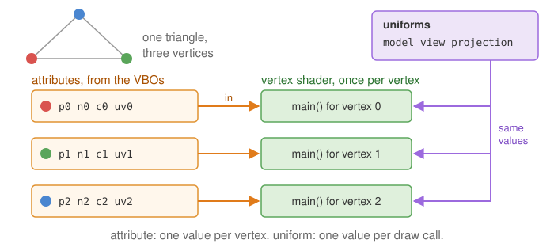
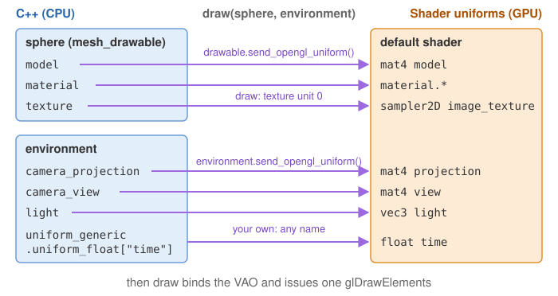

# Shaders and uniforms

A *shader* is a small program written in GLSL that runs on the GPU. CGP draws every
`mesh_drawable` with a pair of shaders:

- the **vertex shader** runs once per vertex: it reads the vertex [attributes](glossary.md#attribute) stored in the
  [VBOs](glossary.md#vbo) and computes the position of the vertex on the screen;
- the **fragment shader** runs once per pixel covered by a triangle (a *fragment*): it computes
  its color.

Between the two, the GPU assembles the triangles, finds the pixels they cover
(*rasterization*) and interpolates the outputs of the vertex shader at each of these pixels.


Shaders receive data in two ways:

| | Per-vertex attribute (GLSL keyword in) | Uniform variable (GLSL keyword uniform) |
|---|---|---|
| Value | different for every vertex | the same for the whole draw call |
| Stored in | a VBO, copied once by `initialize_data_on_gpu` | sent by `draw` before each draw call |
| Examples | position, normal, color, uv | model, view, projection, light, material |



The default shaders are in `shaders/mesh/` of every project, loaded at startup into
`mesh_drawable::default_shader` (see [Scene structure](scene-structure.md)).

## 1. The default vertex shader

```glsl
#version 330 core

// Inputs coming from VBOs (locations fixed by mesh_drawable)
layout (location = 0) in vec3 vertex_position;
layout (location = 1) in vec3 vertex_normal;
layout (location = 2) in vec3 vertex_color;
layout (location = 3) in vec2 vertex_uv;

// Outputs, interpolated and sent to the fragment shader
out struct fragment_data {
    vec3 position; // world space
    vec3 normal;   // world space
    vec3 color;
    vec2 uv;
} fragment;

uniform mat4 model;
uniform mat4 view;
uniform mat4 projection;

void main()
{
    vec4 position = model * vec4(vertex_position, 1.0);         // local -> world
    mat4 modelNormal = transpose(inverse(model));
    vec4 normal = modelNormal * vec4(vertex_normal, 0.0);       // normals: inverse transpose

    fragment.position = position.xyz;
    fragment.normal   = normal.xyz;
    fragment.color    = vertex_color;
    fragment.uv       = vertex_uv;

    gl_Position = projection * view * position;                 // world -> clip space
}
```

The location numbers are the link with the C++ side: `initialize_data_on_gpu` binds
`vbo_position` to location 0, `vbo_normal` to 1, `vbo_color` to 2 and `vbo_uv` to 3. A custom
shader for a `mesh_drawable` must use the same locations. The names of the input variables are
free; only the location matters.

The vertex shader must write `gl_Position`. The matrices are explained in
[Camera and matrices](camera-and-matrices.md). Normals are transformed by the inverse
transpose of the model matrix so that they stay perpendicular to the surface under a
non-uniform scaling.

## 2. The default fragment shader

The fragment shader receives the interpolated struct of the vertex shader (same declaration,
with the keyword in instead of out) and writes one color:

```glsl
layout(location=0) out vec4 FragColor;

uniform sampler2D image_texture;  // the texture of the drawable (texture unit 0)
uniform mat4 view;                // used to recover the camera position
uniform vec3 light;               // light position

struct phong_structure {
    float ambient;
    float diffuse;
    float specular;
    float specular_exponent;
};
struct texture_settings_structure {
    bool use_texture;
    bool texture_inverse_v;
    bool two_sided;
};
struct material_structure {
    vec3 color;
    float alpha;
    phong_structure phong;
    texture_settings_structure texture_settings;
};
uniform material_structure material;
```

Its main function computes a [Phong illumination](glossary.md#phong-shading):

1. the camera position is recovered from the `view` matrix;
2. diffuse term $\max(N\cdot L, 0)$, with $L$ the unit direction towards `light`;
   specular term $\max(R\cdot V, 0)^{s}$, with $R$ the reflection of $L$ and $V$ the
   direction towards the camera;
3. the base color is the product `fragment.color * material.color * texture color`;
4. final color $=(K_a + K_d\,\text{diffuse})\,\text{color} + K_s\,\text{specular}\,(1,1,1)$,
   and alpha $=$ `material.alpha` $\times$ the alpha of the texture.

So a shape can be colored in three ways, which multiply: per-vertex colors (`mesh::color`), one
uniform color (`material.color`), and a [texture](glossary.md#texture).


## 3. Three levels of uniforms

This section is the reference for the uniforms sent by `draw`; the other pages link here.
When you call `draw(drawable, environment)`, CGP activates the shader of the drawable and
sends the uniforms in this order (a later value of the same name overwrites an earlier one):

| Level | Sent by | Uniforms (GLSL names) | You set them with |
|---|---|---|---|
| Drawable | `drawable.send_opengl_uniform()` | `model`, `material.*` | `sphere.model`, `sphere.material` |
| Environment | `environment.send_opengl_uniform(shader)` | `projection`, `view`, `light` | `environment.camera_projection`, `environment.camera_view`, `environment.light` |
| User | the end of `environment.send_opengl_uniform`, which sends `environment.uniform_generic` | any name you choose | `environment.uniform_generic.uniform_float["time"] = ...` |
| Per draw call | `draw`, from its `additional_uniforms` argument | any name you choose | `draw(water, environment, 1, true, water_uniforms)` |
| Texture | `draw` | `image_texture` (unit 0), one sampler per entry of `supplementary_texture` | `sphere.texture`, `sphere.supplementary_texture["name"]` |



Then the [VAO](glossary.md#vao) is bound and one draw command is issued. Every value ends up in a call to
`opengl_uniform(shader, "name", value)`, a wrapper of `glUniform*` that finds the location of
`name` in the shader (with a cache) and sends the value. You can also call `opengl_uniform` yourself with the
shader of a drawable: it sets the value in the program currently in use (it does not call
`glUseProgram`), so outside of `draw` call `glUseProgram(shader.id)` first; the value then
stays in the program until it is changed. For most needs, `uniform_generic` (below) is simpler.

### Drawable uniforms: model and material

`mesh_drawable::send_opengl_uniform` sends the model matrix (built from `model` and two
optional terms, see
[the model matrix of a drawable](transformations.md#6-to-mat4-and-the-model-matrix-of-a-drawable))
and the material. The C++ struct `material_mesh_drawable_phong` maps to the GLSL struct as follows:

| C++ (`sphere.material...`) | GLSL uniform | Default |
|---|---|---|
| `color` | `material.color` | (1,1,1) |
| `alpha` | `material.alpha` | 1 |
| `phong.ambient`, `phong.diffuse`, `phong.specular`, `phong.specular_exponent` | `material.phong.ambient` ... | 0.3, 0.6, 0.3, 64 |
| `texture_settings.active` | `material.texture_settings.use_texture` | true |
| `texture_settings.inverse_v` | `material.texture_settings.texture_inverse_v` | true |
| `texture_settings.two_sided` | `material.texture_settings.two_sided` | false |

Note that two C++ names differ from their GLSL names (`active` / `use_texture`,
`inverse_v` / `texture_inverse_v`).

### Environment uniforms: view, projection, light

They are the same for every shape of the frame, so they live in the environment, which you
fill at the beginning of `display_frame` (see [Scene structure](scene-structure.md)). You can
add your own fields to `environment_structure` and send them in its `send_opengl_uniform`.

### User uniforms: uniform_generic

To send an extra value without touching the C++ structures, put it in one of the maps of
`uniform_generic_structure`: `uniform_int`, `uniform_float`, `uniform_vec2`, `uniform_vec3`,
`uniform_vec4`, `uniform_mat2`, `uniform_mat3`, `uniform_mat4`. The key is the GLSL name; the
map decides the type. Each C++ entry needs a matching declaration in the shader:

```cpp
// C++ (display_frame or display_gui)
environment.uniform_generic.uniform_float["time"] = timer.t;
environment.uniform_generic.uniform_float["coeff_ambient"] = gui.ambient;
environment.uniform_generic.uniform_vec3["light_color"] = gui.light_color;
```

```glsl
// GLSL (vertex or fragment shader)
uniform float time;
uniform float coeff_ambient;
uniform vec3 light_color;
```

The entries stay in the map: they are sent again at every `draw` until you change them.

<!-- demo: uniforms -->
> **Try it.** In this demo a flat grid is drawn with a custom vertex shader that displaces
> its vertices with a wave. The C++ code only sets three user uniforms,
> `uniform_float["time"]`, `uniform_float["amplitude"]` and `uniform_vec3["wave_color"]`:
> move the slider or pick a color and the whole surface changes at once, without touching
> its VBOs.

Uniforms of `environment.uniform_generic` are sent to **every** shader that is drawn with
this environment, including the default shader that does not declare `time`. When a shader
does not use a uniform it receives, `opengl_uniform` prints the warning *"Try to send uniform
variable [time] to a shader that doesn't use it"* (at most `cgp_warning::max_warning` times,
4 by default). This is harmless; the course labs silence it with
`cgp_warning::max_warning = 0;` in `initialize()`. Two other options:

- a separate environment for the shapes that use the custom shader;
- per-draw uniforms: the fifth argument of
  `draw(drawable, environment, instance_count, expected_uniforms, additional_uniforms)` is a
  `uniform_generic_structure` sent only for this call, e.g.
  `draw(water, environment, 1, true, water_uniforms)`: 1 instance (the default), *true* to
  keep the warning for uniforms the shader does not use (*false* silences it for this call),
  then the extra uniforms.

Note also that the GLSL compiler removes a uniform that is declared but not used in the
computation: it then counts as "not used" and triggers the same warning.

## 4. Loading your own shader

A shader program is held by an `opengl_shader_structure`, which only stores the OpenGL `id`.
Write the two files (for instance `shaders/mesh_custom/mesh_custom.vert.glsl` and
`shaders/mesh_custom/mesh_custom.frag.glsl`, starting from a copy of the default ones), then in `initialize()`:

```cpp
opengl_shader_structure shader_custom;
shader_custom.load(
    project::path + "shaders/mesh_custom/mesh_custom.vert.glsl",
    project::path + "shaders/mesh_custom/mesh_custom.frag.glsl");

cube.initialize_data_on_gpu(cube_mesh);
cube.shader = shader_custom;     // copies the id: several drawables can share the program
sphere.shader = shader_custom;
```

Alternatively, pass it at the initialization:
`cube.initialize_data_on_gpu(cube_mesh, shader_custom)`.

- `opengl_shader_structure::load` reads, compiles and links the two files; it stops the
  program with the compilation error if the GLSL is wrong. Shaders are loaded at run time, so
  a change in a .glsl file does not require recompiling the C++ code, only restarting it.
- Use `project::path` to build the file paths: it points to the root of the project
  whatever the folder you run the executable from.
- Loading directly into a drawable also works, even after `initialize_data_on_gpu`:
  `drawable.shader.load(...)` gives this drawable a new program and leaves the default shader
  of the other shapes untouched. `load` never releases the program previously held by the
  struct, because copies of it (other drawables) may still use it; call
  `opengl_shader_structure::clear` explicitly to release a program that no drawable uses
  any more.
- For the web version (Emscripten), `load` converts the `#version 330 core` header to
  OpenGL ES automatically.
- `load_from_inline_text` builds a shader from two strings instead of files.

A custom shader for a `mesh_drawable` keeps the input locations 0 to 3. It may drop uniforms
it does not need (e.g. `material`); `draw` will then print the "doesn't use it" warning for
them, as explained above.

## See also

- [From CPU to GPU](cpu-to-gpu.md): how the VBOs read by the vertex shader are filled.
- [Camera and matrices](camera-and-matrices.md): `model`, `view` and `projection`.
- [Scene structure](scene-structure.md): where the environment is filled.
- [Change the color of a shape](../how-to/change-the-color.md): the material color, per-vertex colors and Phong coefficients in practice.
- [Troubleshooting](../get-started/troubleshooting.md#shaders): shader compilation errors and the uniform warning.
- Course lab of CSC_43043 ([public version](https://github.com/drohmer/csc43043ep-lab-code), without the solutions):
  [`05_shaders/b_shading_effect`](https://github.com/drohmer/csc43043ep-lab-code/tree/main/05_shaders/b_shading_effect) (Phong in a custom fragment shader driven by
  `uniform_generic`).
