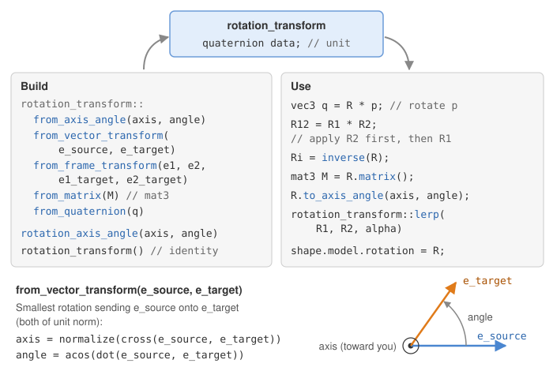
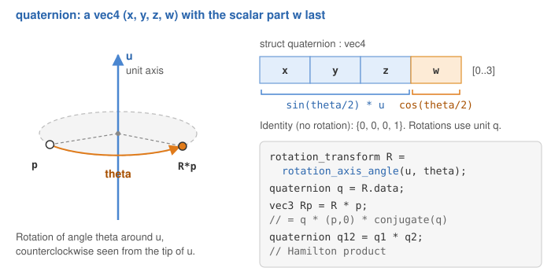
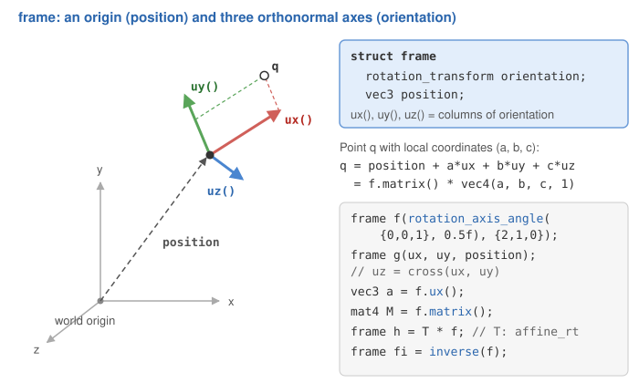
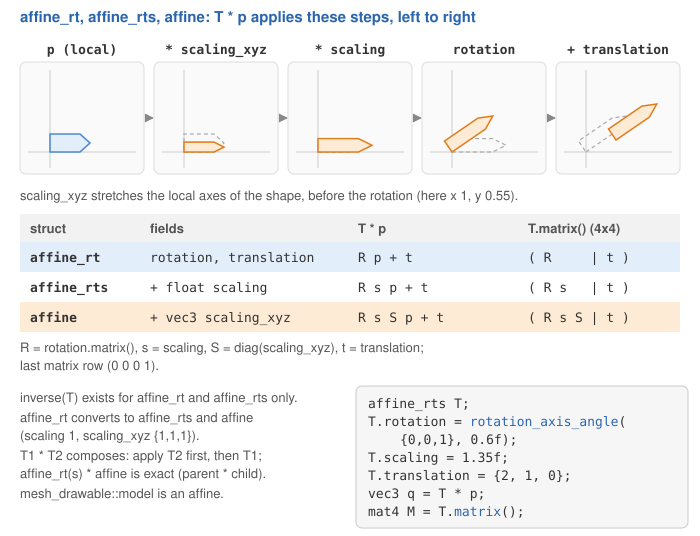
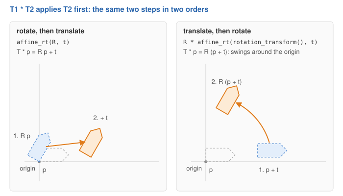

# Rotations, frames and affine transforms

Placing a shape, orienting a camera or animating a joint all come down to the same few
operations: rotate, scale, translate, and chain them. A `mat4` can do all of it, but a 4x4
matrix is hard to read, hard to animate and easy to break (12 numbers that must stay
consistent: change one coefficient of the rotation part and it is no longer a rotation). CGP therefore stores transforms as small structs with named fields, and only
builds the `mat4` at the last moment, when it is sent to the shader.

| Type | Stores | Represents | Inverse |
|---|---|---|---|
| [`rotation_transform`](../reference/rotation_transform.md) | a unit `quaternion` | a 3D rotation | yes |
| [`frame`](../reference/frame.md) | `orientation`, `position` | an origin and three orthonormal axes | yes |
| [`affine_rt`](../reference/affine_rt.md) | `rotation`, `translation` | rigid motion | yes |
| [`affine_rts`](../reference/affine_rts.md) | `rotation`, `translation`, `scaling` (float) | rigid motion + uniform scaling | yes |
| [`affine`](../reference/affine.md) | `rotation`, `translation`, `scaling`, `scaling_xyz` | + scaling along each local axis | no |

The last one is the type of `mesh_drawable::model`; the second to last is the type of the
local transforms of a hierarchy (see [Hierarchies of shapes](hierarchies.md)).

## 1. Rotations: rotation_transform

A `rotation_transform` hides how the rotation is stored (a unit quaternion in its field
`data`) and behaves like a rotation matrix: you multiply it with vectors, matrices and
other rotations. You never fill it by hand; you build it from the description you have:

```cpp
// axis + angle in radians (the axis is normalized for you)
rotation_transform R1 = rotation_transform::from_axis_angle({0,0,1}, Pi/2);

// the rotation that sends one unit vector onto another
rotation_transform R2 = rotation_transform::from_vector_transform({0,0,1}, normalize(direction));

// the rotation that sends a pair of orthonormal vectors onto another pair
rotation_transform R3 = rotation_transform::from_frame_transform({1,0,0},{0,1,0}, u, v);

// from a 3x3 rotation matrix, or from a unit quaternion
rotation_transform R4 = rotation_transform::from_matrix(M);
```



Then:

| Operation | Code | Result |
|---|---|---|
| rotate a vector | `R * v` | `vec3` |
| compose | `R1 * R2` | `rotation_transform`, applies R2 first |
| invert | `inverse(R)` | the opposite rotation |
| matrix | `R.matrix()` | `mat3` |
| image of the axes | `R.matrix_col_x()`, `matrix_col_y()`, `matrix_col_z()` | `vec3` |
| interpolate | `rotation_transform::lerp(R1, R2, alpha)` | rotation between R1 (alpha=0) and R2 (alpha=1) |
| back to axis/angle | `R.to_axis_angle(axis, angle)` | fills its two arguments (a `vec3` and a float) |

Two details save debugging time:

- `from_vector_transform` and `from_frame_transform` **require unit vectors** (and
  `from_frame_transform` orthogonal ones): they assert it with a tolerance of 1e-5, so
  always pass `normalize(...)` of a direction.
- To accumulate a small rotation dR at every frame, the side matters. `R = R * dR`
  rotates the object around one of **its own** axes (dR acts in local coordinates, before
  R); `R = dR * R` rotates it around a **world** axis.

### Quaternions

A `quaternion` is a `vec4` whose scalar part is stored **last**: $(x, y, z, w)$. The
rotation of angle $\theta$ around the unit axis $u$ is
$q = (\sin(\theta/2)\,u,\; \cos(\theta/2))$. The product of two quaternions composes the
rotations, and rotating a vector $v$ computes $q\,(v,0)\,\bar{q}$.



You rarely need them directly: `R.get_quaternion()` reads the one inside a rotation and
`rotation_transform::from_quaternion(q)` builds a rotation from one (it asserts that $q$
has a unit norm). Their main advantages are compactness (4 floats instead of 9) and
interpolation: `rotation_transform::lerp` interpolates the two quaternions, flips the sign
of the second one if needed so that it takes the shortest path, and normalizes the result.

## 2. Frames

A `frame` is a local coordinate system: an origin `position` and three orthonormal axes,
the columns of the rotation `orientation`, returned by `ux()`, `uy()` and `uz()`. The point
of local coordinates $(a, b, c)$ is $\text{position} + a\,u_x + b\,u_y + c\,u_z$.



```cpp
frame f(rotation_transform::from_axis_angle({0,0,1}, Pi/4), {1,0,0});
vec3 const front = f.ux();      // first axis, in world coordinates
mat4 const M = f.matrix();      // local -> world, the same matrix as affine_rt(orientation, position)
frame const g = inverse(f);     // world -> local
```

A frame and an `affine_rt` hold the same data: `frame(T)` converts one into the other, and
`T * f` moves a frame by a rigid transform. The difference is the meaning: a frame *is* a
place (the camera, a joint), a transform *moves* things. The camera of CGP is a frame:
`matrix_view()` returns `inverse(to_frame()).matrix()` (see
[Camera and matrices](camera-and-matrices.md)). The constructor `frame(ux, uy, position)`
builds the orientation from two axes; like `from_frame_transform`, it requires them to be
unit and orthogonal.

## 3. The affine family: what T * p computes

The three affine types add a translation (and scalings) to a rotation. Applied to a point,
they all compute **scale, then rotate, then translate**:

| Type | T * p |
|---|---|
| `affine_rt` | $R\,p + t$ |
| `affine_rts` | $R\,(s\,p) + t$ |
| `affine` | $R\,(s\,S\,p) + t$, with $S = \text{diag}(\text{scaling\_xyz})$ |



Since the scaling comes first, `scaling_xyz` **stretches the shape along its own axes**: a
cube scaled by `{2,1,1}` is a box twice as long along its local x axis, and it stays the
same box whatever its rotation. The matching matrix is

$$
M = \begin{pmatrix} s\,R\,S & t \\ 0 & 1 \end{pmatrix}
$$

All three types also apply to a `vec4`: the translation is multiplied by $w$, so a
direction ($w=0$) is rotated and scaled but not translated.

Each type has setters that return the transform itself, handy to build one in a single
expression: `affine().set_translation({1,0,0}).set_scaling(0.5f)`.

## 4. Composition: T1 * T2 applies T2 first

Products follow the matrix convention: in `T1 * T2`, the transform on the **right** is
applied first. `(T1 * T2) * p` equals `T1 * (T2 * p)`.



The product exists between the rigid and similarity types, and returns the smallest type
that can hold the result:

| Product | Result | Exact? |
|---|---|---|
| `rotation_transform * rotation_transform` | `rotation_transform` | yes |
| `affine_rt * affine_rt` (and with a rotation on either side) | `affine_rt` | yes |
| `affine_rts * affine_rts`, `affine_rts * affine_rt`, `affine_rt * affine_rts` | `affine_rts` | yes |
| `affine_rts * affine`, `affine_rt * affine` | `affine` | yes |
| `affine * affine_rts`, `affine * affine_rt` | `affine` | only if the left `scaling_xyz` is uniform (asserted) |
| `affine * affine` | not defined | use `T1.matrix() * T2.matrix()` |

The reason for the last two lines: a non-uniform scaling followed by a rotation is a
*shear*, which an `affine` cannot store (it always scales before it rotates). A rigid or
similarity transform applied *after* an `affine` is fine: this is the useful case, a
stretched shape (an `affine`) placed inside a parent frame (an `affine_rts`).

A common composition has its own function: `rotation_around_center(R, center)` returns the
`affine_rt` that rotates around a point instead of around the origin,
$p \mapsto R\,(p - c) + c$.

## 5. Inverse

`inverse` exists for `rotation_transform`, `frame`, `affine_rt` and `affine_rts`, and is
exact: for `affine_rts`, $T^{-1} = (R^T,\; -R^T t / s,\; 1/s)$.

There is **no** `inverse(affine)`, on purpose. The inverse of $R\,S$ is $S^{-1} R^T$: the
scaling would have to come *after* the rotation, which the `affine` struct cannot express.
Rather than return a silently wrong result, CGP does not offer it. When you need to invert
a transform (to go from world to local coordinates, to pick an object with the mouse...),
store it as an `affine_rt` or `affine_rts`, or invert its matrix with `inverse(T.matrix())`.

## 6. To mat4, and the model matrix of a drawable

Every transform has `matrix()`, which returns the `mat4` above (a `mat3` for a
rotation). The other way, `affine::from_matrix(M)` and `affine_rt::from_matrix(M)` read
the translation and the rotation back from a matrix (`affine` also recovers the scalings).

A `mesh_drawable` stores its placement in the field `model`, an `affine`. Since `affine`
can be built from an `affine_rt` or an `affine_rts`, you can assign either one to it:

```cpp
// an arrow (a mesh of length 1 along z) going from point a to point b
vec3 const d = b - a;
arrow.model = affine_rts(rotation_transform::from_vector_transform({0,0,1}, normalize(d)), a, 1.0f);
arrow.model.scaling_xyz = {1, 1, norm(d)};   // stretch along the local z axis only
draw(arrow, environment);
```

The `mat4` is built only inside `draw`, by `mesh_drawable::send_opengl_uniform`:

```text
model (uniform) = hierarchy_transform_model.matrix() * supplementary_model_matrix * model.matrix()
                    affine_rts, set by a hierarchy     mat4, identity          affine, yours
```

- `model.matrix()` is applied first, in the local frame of the mesh.
- `supplementary_model_matrix` is a raw `mat4` (identity by default) for whatever the
  affine types cannot express: a shear, a reflection, a projection.
- `hierarchy_transform_model` is the global transform computed by a
  `hierarchy_mesh_drawable`; it is identity for a drawable outside a hierarchy.

The vertex shader then transforms the normals with $(M^{-1})^T$, so lighting stays correct
with a non-uniform `scaling_xyz`.

## Common pitfalls

- **Rotation around the wrong point.** Every rotation turns around the origin of the frame
  it acts in. Build the mesh around its pivot (its center, or the joint) and move it with
  the translation, or use `rotation_around_center`.
- **Degrees.** `from_axis_angle` takes radians: write `30 * Pi / 180`.
- **Reading products backwards.** `T_world * T_local` places a local transform inside a
  parent; `T_local * T_world` is almost never what you want.
- **Non-unit vectors.** `from_vector_transform({0,0,1}, b - a)` aborts on an assertion: pass
  `normalize(b - a)`.

## See also

- How-to: [Move, rotate and scale a shape](../how-to/transform-a-shape.md)
- Understand: [Camera and matrices](camera-and-matrices.md) (model, view and projection),
  [Hierarchies of shapes](hierarchies.md) (composing transforms along a tree)
- Reference: [`rotation_transform`](../reference/rotation_transform.md),
  [`quaternion`](../reference/quaternion.md), [`frame`](../reference/frame.md),
  [`affine_rt`](../reference/affine_rt.md), [`affine_rts`](../reference/affine_rts.md),
  [`affine`](../reference/affine.md), [`mat4`](../reference/mat4.md)
